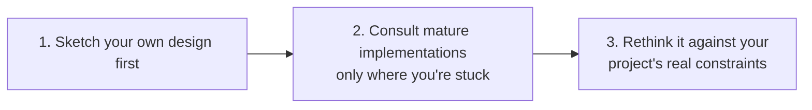
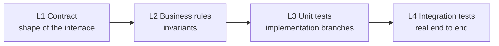
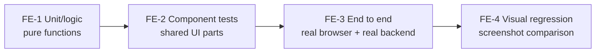
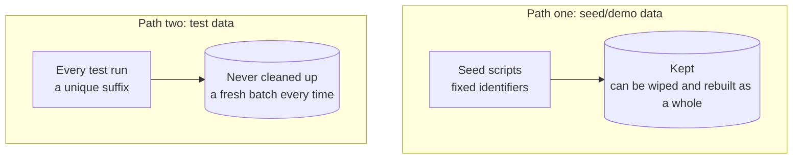

# BrickKit — part 9 of 11 (English)

Contains: docs/en/09-patterns/01-component-design.md, docs/en/09-patterns/02-testing-strategy.md, docs/en/09-patterns/03-test-types-and-acceptance.md, docs/en/09-patterns/04-seed-data.md, docs/en/09-patterns/05-service-calling.md

File paths below are relative to the repository root, https://raw.githubusercontent.com/brickKit/brickKit/main/ ; links inside pages are relative to this file

Next: https://raw.githubusercontent.com/brickKit/brickKit/main/llms/en/10.md

---

> File: docs/en/09-patterns/01-component-design.md

# Component design

This page is **recommended practice**, not a platform rule. How a component's domain model is designed inside is none of
the platform's business — it belongs to whoever builds the component. The method below comes from a real production
deployment: research before designing, watch for one particular signal while researching, then decide where the boundary
goes.

## How big a component should be

**One component covers one domain concept.** "Basic personnel data", "the department tree", "password login", "role
authorisation" are each one component; "the HR system" isn't — it's a family of components.

**For scale.** The project's own 10 test components (`tests/components/`) range from a little over two hundred lines of
code to about three thousand six hundred. That order of size has two advantages:

- One person or one AI can read and understand the whole component in one go, without guessing their way around a
  codebase of hundreds of thousands of lines.
- The component's boundary is written in `component.yaml` and its contracts; someone reading the component only needs those
  two, plus its direct dependencies.

This isn't a hard rule: a component that grows to five thousand lines while really covering one thing doesn't need
splitting to meet a number. Conversely, a three-hundred-line component looking after both "orders" and "stock" should be
split. Line counts are a symptom; the domain concept is what decides.

## Start from reference implementations, not a blank page

Designing business logic should almost always begin by looking at how mature software solves the same problem. A domain
model polished by years of real deployment has absorbed the edge cases a from-scratch design is almost sure to miss —
misses that usually surface three months after a customer goes live, not in the design review.

**The order matters, and the reverse order is worse than no research at all:**



| Step | Do | Why in this order |
| --- | --- | --- |
| 1. Design your own version first | Before opening any reference implementation, sketch a version from your own project's real constraints | Only with your own plan in hand do you see where they differ; read with an empty head and you just produce a copy |
| 2. Look only for what you can't work out | How to cut the domain model, which states a state machine has, which transitions are legal, which fields are required, how edge cases are handled | This step is research, not copying homework — you already know what you're looking for |
| 3. Come back and think it through, then write | Digest what you learned against your own project's real constraints | A reference project's stack and boundaries are almost never the same as yours; what you borrow is its reasoning, not its code |

**Closed-source products are worth consulting too**, even without their source. You can still watch how they're used in
the real world: which features customers use every day, which nobody ever clicks, which flows have been complained about
for years. When judging "is this capability worth its own component", that kind of information is often more useful than
source — and that judgment matters more than any implementation detail, because it comes earlier and is harder to correct
afterwards.

**About licences**: understanding an implementation's reasoning and then re-implementing it independently (even in
another language) isn't a derivative work. What to avoid is opening their source files and copying line by line.
Following the three steps above keeps you well clear of that line. If you really want to use code directly, only under
permissive licences (Apache-2.0 / MIT / BSD), keeping the original copyright notice.

**Write down what you consulted** in the component's design notes, before implementing. Writing it then is cheap;
reconstructing it later, when someone asks "why does this field look like this", is expensive:

```markdown
## Implementations consulted

| Project | Version/commit | Module consulted | What was borrowed | Licence (verified) | Use |
|---|---|---|---|---|---|
| Odoo | 17.0 | `addons/product/models/product_uom.py` | Table design and rounding strategy for unit-of-measure conversion factors | LGPL-3 | Borrowed reasoning |
| A closed-source product | — | — | Real everyday patterns of multi-unit conversion | Closed source | Borrowed usage patterns |

**Deliberately not consulted** (say so, so that later readers don't think it was overlooked):

**Approaches deliberately avoided** (name the anti-patterns found in the references, and why this component doesn't repeat them):
```

The "Use" column takes only three values: **borrowed reasoning** (understand why it was designed that way, then implement
independently — nearly every row should be this), **borrowed usage patterns** (closed-source products, or only docs and
interaction observed), **copied code** (only Apache-2.0 / MIT / BSD, keeping the copyright notice, saying exactly which
file and which part).

## Weaknesses common in reference implementations

Reading several mature implementations in one domain, you often find they share the same set of structural weaknesses,
mostly inherited from the same kind of early architecture. Recognising them as you read is a chance to deliberately not
repeat them:

| Common weakness | How to avoid it |
| --- | --- |
| Every module shares one process and one database, cross-module joins are routine, and module boundaries become "soft" ones anyone can step over | Separate components with separate schemas, the boundary kept by access rights rather than convention — exactly the boundary the component model gives you already |
| Customisation by runtime patching and hooks into the base implementation, so every upgrade may break every customisation | A separately versioned fork plus a locked contract, turning the upgrade into an explicit merge |
| Everything metadata-driven (dynamic fields, a generic "document type"), with no static types to catch errors before run time | A real contract, plus static types where the language supports them |
| Reports query live transaction tables directly, and one heavy query drags down the transaction path | Reports go to summary tables or a dedicated component, never touching the live transaction path |
| Tables grow without limit, and sooner or later the system is crushed by its own history | Design partitioning and archiving for tables that keep growing from day one |

## Component or config switch: recognising a "slot family"

Comparing reference implementations, one situation keeps coming up: **the same feature has genuinely different
implementations in several mature systems, each of them reasonable, only suited to different customers.**

That isn't a "should it be configurable" question. It's telling you the feature needs **a family of interchangeable
components**, not a switch hidden inside one component. It turns on that qualifying condition:

- After comparing, one is **clearly better** → that's the only version you should implement; no family needed.
- Several implementations **each hold up, serving genuinely different customers** → worth making into a family of
  independent, interchangeable components.

| Feature | The real divergence in reference implementations | Conclusion |
| --- | --- | --- |
| Costing method | Moving weighted average / FIFO / standard cost / actual batch cost, each suited to different industries | A family |
| Warehouse picking strategy | First-expiry-first-out / FIFO / nearest location / wave picking | A family |
| Approval routing | Strict hierarchy / tiered by amount / matrix / rule engine | A family — but it's business logic, so it goes in a business-facing component; don't expect a platform mechanism to express it |
| Document numbering | Sequential / segmented by year and month / segmented by organisation and type | **Not** a family — one config item is enough |
| Which fields a master-data record has | Each just has "a few more fields, a few fewer" | **Not** a family — that's customisation, not architecture |

### What a family of interchangeable components looks like on BrickKit

1. **Each member is an independent component**: its own repository, its own `component.yaml`, its own version history.
   `pricing/costing-fifo` and `pricing/costing-standard` are two components, not two modes of one component.
2. **Every member's external contract is exactly the same.** Calling code written against one member works unchanged
   against another — that's what "interchangeable" means.
3. **Nobody may declare a dependency on a particular member.** A component's `dependencies.components` names an exact
   component ID and exact version, fixed in its `component.yaml` when it's released, and the project using it can't
   re-point it afterwards; nor does the platform offer dependency aliases (the variable name is derived from the component
   ID — seeing `PRICING_COSTING_FIFO_ENDPOINT` you know what it points at, and an alias would break that derivation). So a
   component that calls this slot **doesn't** write `pricing/costing-fifo` as a dependency; it declares an address config
   item in `configSchema` (say a required `COSTING_URL` without a default), which the project assembling the system fills
   in with the member it actually installs: `COSTING_URL: $endpoint:pricing/costing-fifo`. The platform works out the
   address (versioned, rewritten for shells and processes on this machine); when several components use it, write it once
   in `config/vars.yaml` — see [Another component's address](../../docs/en/01-three-layers/06-vars-and-var-ref.md). Once anyone
   declares a dependency on a member, that member is no longer replaceable.
4. **Settle the family before writing implementations**: the names, the shared contract, which customers each member
   serves, and which one a new project installs by default.
5. **The shared contract lives in no member's repository.** Put it in a contract repository of its own (interface
   definitions, events, the list of capabilities), and have each member reference it at an exact version. Kept in the
   first member, it makes the second member depend on its competitor.
6. **"The same contract" has to be provable.** Write a black-box conformance suite: it talks to a **running** member only
   through the contract and checks the results, blind to the implementation and to the language it's written in; bring
   the member and what it needs up with `brickkit up --focus <member>`, and run the suite against it. Every member runs
   the same version of the suite before each release, and passing it is what makes it a member of the family. Where
   members may differ in capability, the contract lists the capabilities, and the suite tests what a member declares.

**Don't write `if costingMethod == "fifo"` inside one component to fob off a real slot signal.** That crams several
customer groups' genuinely different needs into one codebase, and from then on each customer's needs hold back everyone
else's releases. **The exception**: a divergence small enough for two or three conditional branches, with no third or
fourth variant in sight — splitting out a whole component for that is over-design of another kind.

## Background tasks: the same code may be running several times at once

Scheduled jobs, message consumers, clean-ups — the platform schedules none of them: they live in the component's own
process, and are the component's business. What the component needs to know is when the platform runs the same code
several times at once:

- `replicas` above 1 on K8s: every replica runs your scheduled job.
- A rolling update on K8s: old and new Pods overlap for a while, both running.
- Several versions side by side: two versions of one component running together, often against the same database.
- A shell: a member's tasks run in the shell's process, sharing CPU and connections with the other members; one heavy
  scheduled job slows every member in that process, so give it a limit.

On Docker / Podman each component is one container, stopped before its replacement starts, so none of this shows on a
single machine — it appears on K8s. Write for one of three shapes:

| Shape | Example | How it's done once |
| --- | --- | --- |
| Singleton | Syncing a directory from an outside system every five minutes | A lease or a database advisory lock: whoever holds it runs, the others skip |
| Once per time slot | The reconciliation at 02:00 each day | Record "done" keyed by the slot (the date): a second run finds it done and exits |
| Competing claims | Working through the rows of a queue or an outbox table | `SELECT … FOR UPDATE SKIP LOCKED`, or a message queue's consumer group: several run in parallel, each row is taken by one |

Write it from the start as if several copies may be running: it stays correct with one replica, and scaling out needs no
code change.

## Failure modes to avoid

**The god component.** One component looks after everything: users, permissions, orders, reports. The symptoms: dozens of
unrelated items in `configSchema`; changing one feature means releasing the whole component; a problem anywhere restarts
all of it. For the direction of the split, see the three questions in the next section.

**Too many dependencies.** One component depends directly on seven or eight others. Every one of them has to be up before
it can start, and whenever any of them changes its contract, it has to change too. Two common causes:

- It's really a **connector component** (orchestrating several standalone components to complete one flow) written as an
  ordinary business component — make orchestration its explicit job, and don't let other components depend back on it.
- It's doing its dependencies' work for them (assembling another component's data itself, say) — hand that capability
  back to the component it belongs to.

**Splitting too far.** Two components share a rule that "must hold at every moment", yet they were split — there are no
transactions across components, and sooner or later the rule gets broken.

## If your team speaks DDD

You're not required to use DDD. This is just a mapping: if your team already uses words like bounded context and
aggregate, here's what they correspond to in BrickKit. This section isn't backed by a review of a real deployment; it
translates the platform's existing mechanisms into DDD terms, plus a few recommended tests.

| DDD concept | What it corresponds to in BrickKit | Why |
| --- | --- | --- |
| Bounded context | At least one component; a component shouldn't straddle two contexts | A component decides its model and manages its schema itself |
| Aggregate (consistency boundary) | Must go into **one component** | Components only call each other directly by request/response, the platform isn't on the call path, and there are no cross-component transactions to rely on |
| Ubiquitous language | Component IDs and the key names in `configSchema` | The component ID turns, unchanged, into a variable name in the caller's code (`people/basic` → `PEOPLE_BASIC_ENDPOINT`), so name it with the domain's words, not the implementation's |
| Published language / open host service | The contract files in `artifacts` | See [Contracts and artifacts](../../docs/en/03-component-guide/06-artifacts-and-contracts.md) |
| Customer–supplier | The caller pins the supplier's exact version in `dependencies` | No implicit upgrades; upgrading is an explicit change the caller makes itself |

**One term easy to get backwards.** In DDD, "upstream" is the supplier depended on and "downstream" the consumer. When
BrickKit says a component "follows the ones above it", "above" is **the side depending on others** — the top level is the
components nothing depends on. So BrickKit's "above" corresponds to DDD's downstream, and "below" to DDD's upstream.

**Whether to split: ask three questions** (a recommended test, not a platform rule):

1. Is there a rule between the two pieces of data that **must hold at every moment** (say "a balance can never be
   negative", constraining both the account and its ledger)? Yes → put them in one component.
2. Do they need to be **released separately, owned by different people or different customers**? Yes → split them. A
   component is one unit of release, one unit of versioning, one unit of permissions.
3. Once split, can callers write their calling code from the contract alone, without knowing which tables the other side
   has inside? No → the boundary is wrong; go back to question 1.

These three questions answer "should two things be in one component"; the slot family in the section above answers
"should a feature become a family of interchangeable components". They don't conflict.

---

> File: docs/en/09-patterns/02-testing-strategy.md

# Testing strategy

This page is **recommended practice**. The platform stays out of how components are tested inside: language, framework
and test tools are the component's own choice, and the platform only asks for three things — `component.yaml`, a health
check, environment variables. The layered approach below comes from a review of a real production deployment (14
components, including a frontend, covering one complete business loop). To the platform, a frontend component is just
like any other — a container with a port and a health check — so this approach covers both sides: first four layers for
backends, then four for frontends.

## Select acceptance goals by capability

Determine the outcomes needed before organizing cases into backend/frontend layers. Selection and evidence management
are additional recommendations, not a claim that the production review validated every scenario.

1. **Inventory objects and capabilities**: deployable units and runtime forms, background work and instance counts,
   operations spanning transactions or stores, interfaces and implementations, persistent data and upgrades, frontends,
   delivery environments and promises. A shell is a merged-process form; one process may cross transactions. The CLI
   lacking a business database does not remove its assembled components' storage risks.
2. **Select for each object** using the conditions and minimum outcomes in
   [Test types and scenario acceptance](../../docs/en/09-patterns/03-test-types-and-acceptance.md), before matching existing test names. An object can
   be a worker, an interchangeable implementation and a shell member at once; combine applicable conditions. Explain
   non-applicability and mark unpromised rollback, offline or capacity targets as pending. Revisit changed capabilities
   and promises.
3. **Plan verification** with the layers and responsibilities below, specifying the basis, owner, tier, actual command
   and required environment. General techniques and scenarios overlap; one suite can prove several outcomes without
   adding a layer for every type.
4. **Implement and accept** in the specification-first order, then use the acceptance record at the end of this page
   to identify uncovered, skipped and pending outcomes.

## Backends: four layers of tests



| Layer | Checks | Specifically |
| --- | --- | --- |
| L1 Contract tests | The interface's shape to the outside | No breaking change to the contract; every endpoint really works across a process boundary — over the real protocol and real serialisation, not just a local function call that passes |
| L2 Business-rule tests | The properties the feature should have | Invariants (a balance can't go negative), legal state transitions, idempotency, edge cases |
| L3 Unit tests | This implementation's branches | Every branch, condition and error path the current code actually takes |
| L4 Integration tests | The real path end to end | Against a real database and a real message queue, all the way from the request coming in to the write or the message sent |

Two further dimensions **run through every layer** — not a fifth layer, but covered along the way while writing each one:

| Dimension | Covers |
| --- | --- |
| Permissions and data scope | The boundary of what different identities, with different ownership scopes, can see. It goes into every layer, not tested once and done |
| Cross-component calls | Actual protocols and dependency behaviour need real-path evidence; substitutes test the component's own rules and orchestration, as described below |

### Telling L2 from L3

L2 and L3 are the easiest to confuse: both look like testing "whether the feature is right". One test is enough:

> Delete this feature's implementation entirely and rewrite it in another language — should this test still hold? Yes →
> L2; no → L3.

"Two requests with the same idempotency key leave only one record" — has to hold in Go and in Python alike: L2. "The amount
field is parsed as `Decimal`, not `float`" — only meaningful for the current implementation: L3.

### Two traps actually fallen into

**Trap one: testing idempotency only by "replaying once".**

| Don't | Symptom | Instead |
| --- | --- | --- |
| Test only serial replay: send once, send again, assert the results match | An implementation that "first `SELECT`s whether it exists, then `INSERT`s if not" inserts twice when two concurrent requests both fall into the "not found yet" window, leaving two records. Serial replay never hits that window, and the test stays green | Switch to an atomic write (like `INSERT ... ON CONFLICT DO NOTHING`); the test must include "several requests with the same idempotency key arrive at once, and only one really runs" |

**Trap two: testing permissions only at the two ends.**

| Don't | Symptom | Instead |
| --- | --- | --- |
| Test only "someone with permission sees what they should" and "someone with no permission sees nothing" | The permission branch is wrong and returns the whole table: the no-permission user is stopped earlier anyway, and the rows the permitted user sees are themselves correct (they just see other people's too) — both tests pass every time | Build two pieces of data in different ownership scopes (different owners, departments, warehouses), query as one identity, and assert the result contains **none at all** of the other's data — not merely "not empty" or "empty" |

## Frontends: four layers of their own

The same thinking — specification apart from implementation, shared things before specific ones, real environments over
simulated ones — with different tools and boundaries:



| Layer | Checks | Specifically |
| --- | --- | --- |
| FE-1 Unit/logic | Whether the logic computes right | Pure functions, composables, state management; every network request mocked, no rendering |
| FE-2 Component tests | The shared UI parts themselves | Tables, form templates and generic cards reused by several pages — breaking one breaks every page using it, so they naturally come before parts specific to one page |
| FE-3 End to end | Whole business flows | A real browser + a real backend (the whole assembly running). Named by "the business flow verified", not "which button was clicked" |
| FE-4 Visual regression | Whether spacing, density and usage are consistent across pages | Screenshots compared along the way when FE-3 reaches key pages, without starting a browser again. The baseline is updated together with intended UI changes |

FE-2/FE-3 exercise menus, buttons and direct page access for each role; backend authorization remains independently tested.
Shared interactions include loading, empty and failure states. Localization, supported browsers/devices and accessibility
requirements trigger their own checks; visual comparisons fix fonts and rendering environments. See
[Frontends and localization](../../docs/en/09-patterns/03-test-types-and-acceptance.md#frontends-and-localization) for conditions and minimum outcomes.

**When to write FE-3/FE-4**: add them in bulk once page interactions have mostly settled. While pages are still changing a
lot, every change drags selectors and assertions along with it, and the payoff is poor. The skeleton and directory
conventions can be settled early.

**Before having an AI run FE-3 or FE-4, get the user's agreement.** What's expensive isn't the tools but "an AI really
driving a browser, debugging selectors through screenshots or reading the DOM". Say beforehand which flow is being tested
this time and which pages it covers, and wait for the user to confirm. The cost is mostly in writing and debugging; running
an already stable suite with a text report costs about as much as unit tests. To lower the cost of writing them the first
time: confirm elements with accessibility-tree snapshots (structured text) rather than a full-page screenshot every time;
on failure, read the text stack first and take a screenshot only if that doesn't tell you; have a person record the key
paths where possible.

**A trap actually fallen into: not catching "the backend refused".**

| Don't | Symptom | Instead |
| --- | --- | --- |
| Write data loading as `try { await load() } finally { ... }` with no `catch` — because the mocked backend in FE-1 always succeeds | When the real backend legitimately refuses (403, a validation error, a dropped connection), the rejection becomes an exception nobody catches: one framework warning in the console, the page stuck blank or loading, and the user sees nothing | Every load/refresh function has an explicit `catch` and shows a visible error state. It's also why FE-3 has to hit a real backend: a mock can't test "was a real refusal handled" |

**Frontend types drifting from backend contracts: prevent it with a mechanism, not with more tests.** A hand-written
frontend type annotation says "matches the backend contract", with nothing to guarantee it. Generate frontend types and
request functions straight from the backend contract (an OpenAPI file, a GraphQL schema), and type checking stops every
drift at compile time, at zero extra cost for each endpoint added afterwards.

## A component's tests and integration tests

### Test ownership

| Owner | Main responsibilities |
| --- | --- |
| CLI and platform maintainers | Algorithms, parsing, configuration and generation, atomic file changes, process supervision, real-engine wiring, installable artifacts, documentation and checkers |
| Component maintainers | Interfaces, rules, permissions, real dependencies, competing workers, failure recovery, persistent-data upgrades and the component's runtime contract |
| Shared-contract and suite maintainers | Reviewed expected answers, capabilities and versions, common assertions for interchangeable implementations, positive and negative suite fixtures; implementations integrate the suite |
| Shell and member maintainers | Equivalent behaviour for the same member version in standalone and merged forms, identity/configuration/resource isolation, initialization and shutdown |
| Assembling project and delivery maintainers | Real deployment, whole business flows, supported version and environment combinations, delivery and operational promises; component tests alone do not accept the assembly |
| Frontend maintainers | Pure logic, interactions, real backend wiring, permission visibility; visual, localization, browser and accessibility checks where applicable |

A member passing alone does not accept its shell form, and all components passing separately do not accept the
assembly. See [Proving the specific scenarios](../../docs/en/09-patterns/03-test-types-and-acceptance.md#proving-the-specific-scenarios).

### A component's own tests: run on their own

Local L1–L3 contract, rule and implementation checks run in the component's own repository without other components or
BrickKit; L1's cross-process protocol connectivity is verified separately in a real integration environment. Dependency
addresses come from environment variables, which the test sets itself; an optional dependency's variable may not exist at
all, so treat "the variable doesn't exist" as an input to test too — how the component degrades then is its own business
logic.

**Substitutes are useful within their evidence boundary.** Mock-call assertions establish arguments and call counts;
assertions on substitute results can verify this component's rules, but cannot prove the real dependency's transactions,
protocol or side effects. Teams maintaining a fake and real implementation run identical contract assertions against both,
with the real implementation actually executed.

### Integration tests: real containers, cross-component calls

L4 uses BrickKit to bring up the real dependencies. To judge whether a cross-component test is written right, look for
three things:

1. **It produces data on the spot through the dependency's real interface**, rather than bypassing the interface to read or
   write its storage directly.
2. **When the dependency's contract has no way to produce that data, the capability is added to its contract first** —
   never working around the contract, never writing its database with SQL.
3. **Whether the result is right can only be verified with the dependencies really up** — exactly the half a mock can't do.

In the component's own repository, bring the dependencies up with a workbench (see
[Developing inside a component](../../docs/en/03-component-guide/05-local-dev-fractal.md)): the dependencies run in containers, the
component under test runs on this machine as `mode: debug`, and the tests hit it directly.

## Spec first, then implementation (especially when an AI writes the component)

This section is a **recommended working order**, without a real deployment review behind it like the ones above.

**Why the order matters.** Write the implementation first and the tests afterwards, and the tests become a restatement of
the code already written — they verify "the code does what it does", not "what the code should do". For tests to really
constrain anything, there has to be a specification that doesn't depend on the implementation first. A component happens
to have three, all in `component.yaml`, available without reading a line of implementation:

| Specification | Where | Constrains |
| --- | --- | --- |
| The config spec sheet | `configSchema` | Which environment variables the component reads, their defaults, which are required |
| The dependency declaration | `dependencies` | Which `*_ENDPOINT` variables the component receives (an optional dependency not running is **not** injected; see [The environment variable contract](../../docs/en/06-architecture/03-env-injection-contract.md)) |
| The interface contract | The contract files in `artifacts` | What the component promises to the outside (see [Contracts and artifacts](../../docs/en/03-component-guide/06-artifacts-and-contracts.md)) |

The recommended order:

| Step | Do | How you know the step is right | Containers? |
| --- | --- | --- | --- |
| 1 | Complete `component.yaml`: `dependencies`, `configSchema` (keys, defaults, `required`), contract files | `brickkit lint`, then `brickkit up --dry-run` in the workbench (see below) | No |
| 2 | Write L1 from the contract | They must all be red now, and red for a reason (the endpoints aren't implemented yet). Green on the first run means it tests nothing | No |
| 3 | Write each L2 business rule as a sentence first, then turn it into a test | Likewise red first | No |
| 4 | Write the implementation until L1 and L2 are all green | The tests are the acceptance | No |
| 5 | Add L3: this implementation's branches | Every branch is reached | No |
| 6 | Run L4: `brickkit up` starts real dependencies, and a real path is walked through | Works end to end | Yes |

**Step 1's checks come from BrickKit.** `brickkit up --dry-run` starts nothing, but the checks of the injection stage run
as usual, so wherever `component.yaml` and `config/` disagree shows up right there. Here's the real output (an excerpt) when
`demo/hello`'s config key `GREETING` is written as `GREETTING`:

```text
⚠️ demo/hello@1.0.0: GREETTING is not declared in the component's configSchema, so it has no effect
   File: config/demo-hello.yaml
   Declared keys: GREETING
   Suggestion: Did you mean GREETING?
```

The same step also stops: a config item name colliding with a platform-reserved variable (a warning); a key in `required`
with neither a default nor a value from the project (**blocking** — `--dry-run` stops with exit code 1 too).

**How to write step 3.** Start with a "given… when… then…" sentence, then a case table of input/initial state, action,
expected outcome and specification basis. Cover both sides of boundaries, rejection paths and forbidden transitions;
review the expectations before turning them into tests. The idempotency
rule from trap one, written out:

> Given an idempotency key not yet processed; when two requests with the same key arrive at once; then only one really
> runs, and the other gets the same result.

That sentence is itself the most precise prompt you can give an AI, and it points straight at the concurrency window that
serial replay can't reach.

## Execute acceptance and record evidence

Use one record per object or capability; matching an existing test's name is not coverage:

| Object or capability | Types | Minimum observable result and specification | Owner, tier and actual command | Evidence state |
| --- | --- | --- | --- | --- |
| Two workers competing for one job | T19 | Execution count and final business state satisfy the idempotency contract; recovery after an instance exits follows its promise | Component maintainer; integration/release tier; register the actual entry point | Record specification, implementation and execution separately |

**Specified, implemented and executed successfully are separate states.** Also record failures, skips, not run,
uncovered, pending decisions and reasons for non-applicability. Release evidence includes the commit, contract version,
environment and output. A name containing `Upgrade`, `E2E` or `Contract` is insufficient unless its assertions prove this
row's outcome. Do not invent commands for suites that have not been implemented.

Start with specification-derived case tables, including both sides of boundaries, rejection paths and forbidden
transitions. Coverage measures execution, snapshots measure output differences and mutation cannot establish whether
expectations are correct. Keep minimized fuzz counterexamples and seeds in daily regression. Explain and review changes
to expectations, fixtures, generators and snapshots. Investigate the specification and implementation first; do not
delete assertions, narrow inputs or rerun until green. Checker fixtures invoke the actual checker and assert the intended
rule, so unrelated failures cannot masquerade as success.

Development runs may explicitly skip unconfigured real dependencies. A specifically requested integration or release
acceptance lacking its environment remains incomplete and cannot count as passing; dedicated entries should exit with
failure. Register actual commands, owners, tiers and environments; report passing, failing, skipped and not-run cases
separately. Revisit the catalog for new capabilities or promises. Existing CLI-repository commands and their evidence
boundaries are documented in [Contributing](../../CONTRIBUTING.md#test-selection-and-execution-evidence).

---

How to plan seed data and test data: [Seed data](../../docs/en/09-patterns/04-seed-data.md).

---

> File: docs/en/09-patterns/03-test-types-and-acceptance.md

# Test types and scenario acceptance

This reference accompanies [Testing strategy](../../docs/en/09-patterns/02-testing-strategy.md): look up applicability, minimum outcomes and
specific acceptance criteria by type. The strategy owns selection, layering, responsibilities and execution evidence;
this page keeps the details available for consultation as needed. These are recommendations, not claims that every suite
exists or universal component release conditions. Components choose their language, framework, business protocols,
degradation and recovery; the platform verifies mechanical assembly and projects verify assembled outcomes.

## Test catalog

IDs connect tests to acceptance records. General techniques and specific scenarios overlap: one suite may prove several
outcomes. Boundary, error, compatibility and security dimensions apply throughout. Suggested tiers are development,
pre-commit, release/integration acceptance, scheduled and runtime. Budget quick regressions separately from extended
fuzzing, mutation, performance comparisons and drills.

### Behaviour, interfaces and real dependencies

| ID / type | Condition and owner | Minimum result | Suggested tier |
| --- | --- | --- | --- |
| T01 Unit | Platform, component and library implementers | Specified return values, error codes, state and effects; branch coverage with controlled time and randomness | Development, pre-commit |
| T02 Business rules and state transitions | Components with business invariants | Implementation-independent rules, accepted and rejected transitions, idempotency and boundaries; expectations from requirements tables | Development, pre-commit |
| T03 Interface contracts and compatibility | API, event, configuration and CLI contract maintainers | Correct shapes, errors and payloads; detect breaking changes, preserve supported old-file semantics and independent-release combinations | Pre-commit, release |
| T04 Real cross-component protocol | Components and callers | Prepare data through real interfaces; verify results through serialization, authorization and error propagation without writing another component's storage | Release/integration acceptance |
| T05 Real-dependency integration | Database, queue, object-store or engine users | Correct queries, constraints, real commits, locks, persistence, protocols and wiring; query counts satisfy interface budgets | Pre-commit or integration environment |
| T06 Migration and repeat execution | Components with storage migrations | Real-store schema, data and repeated execution follow the migration contract | Pre-commit, release |
| T07 Permission and data-scope matrix | Components with identity, tenant, ownership or field permissions | Identity by operation by scope by field; correct grants, denials, exclusion and trimming; no omitted new entry points | Pre-commit |
| T08 Optional and failing dependencies | Components with optional dependencies or external calls | Missing variables, unreachable dependencies and timeouts follow the component's failure or declared degradation contract | Development, integration acceptance |

### Finding counterexamples and checking shared specifications

| ID / type | Condition and owner | Minimum result | Suggested tier |
| --- | --- | --- | --- |
| T09 Property | Owners of graphs, calculations, ordering and merge rules with many combinations | Independent conservation, idempotency, ordering, node preservation or round-trip properties; reproducible inputs and seeds | Small pre-commit runs, larger scheduled runs |
| T10 Fuzz | YAML, reference-expression, file and protocol parser maintainers | Malformed input cannot crash or bypass constraints; required rejections occur, valid inputs preserve semantics or round-trip properties | Corpus pre-commit, extended scheduled runs |
| T11 Golden, snapshot and characterization | Large-output, rendering and pre-refactor behaviour maintainers | Reviewable differences, normalized timestamps/random identifiers, missing baselines fail; explicit business assertions remain | Pre-commit |
| T12 Scoped mutation | Core rule and validation maintainers, especially AI-written code | Broken conditions or removed validation are detected; explain surviving mutations without treating a score as correctness | Critical changes, scheduled |
| T13 Semantic vectors / known answers | Shared multilingual, codec or signature semantics; contract owners supply, implementers integrate | Standard results/errors for common inputs, including rejection cases; explicit bytes, time and randomness; never automatically accept answers from the implementation under test | Development, pre-commit |
| T14 Black-box runtime conformance | Shared runtime protocol owners and implementers | Running authorization, errors, idempotency, configuration and lifecycle satisfy the protocol; interface files alone cannot prove it | Pre-commit subset, full release suite |
| T15 Interchangeable implementation conformance | Shared-contract owners and interchangeable components, adapters or third-party implementations | The same versioned suite proves interchangeability, declared capability differences and consumer compatibility | Each implementation's release |
| T16 Fake/real shared contract | Teams maintaining both a substitute and a real implementation | Both run identical assertions; the fake passing does not replace real-implementation evidence | Pre-commit, real-dependency acceptance |
| T17 Checker and suite self-tests | Custom lint, architecture gate, checklist and black-box suite maintainers | Good fixtures pass; each singly broken fixture fails the intended rule; invoke the actual checker | Checker changes; fast cases pre-commit |

### Concurrency, recovery and runtime forms

| ID / type | Condition and owner | Minimum result | Suggested tier |
| --- | --- | --- | --- |
| T18 Runtime race detection | Implementers with concurrent shared memory | No detected data races on exercised paths; no inference about cross-instance business idempotency | Pre-commit |
| T19 Multi-instance business contention | Concurrent jobs, consumers, claims, leases or locks; component/library maintainers | Real instances compete for one key, job or time slot; verify execution counts, data and final state, including exits and retries | Integration environment, release |
| T20 Failure injection and workflow recovery | Transactions, components or stores crossed by a flow; delivery, compensation, retry and reconciliation owners | Recovery after step failure, crashes, duplicate/out-of-order delivery or a lost downstream-success response; no duplicate business effects | Integration, release; scheduled as needed |
| T21 Atomic operations and failure rollback | CLI installation, removal, upgrade, release or atomic-write maintainers | Observable files, tags, caches and business state at each failure point match that operation's guarantee, beyond an error return | Pre-commit |
| T22 Lifecycle and shutdown | Process supervisors, background work and shell/component maintainers | Initialization failure, cancellation, exit, signals, children and unfinished work are handled as contracted | Pre-commit, real-runtime acceptance |
| T23 Standalone/shell equivalence | Members supporting both forms and their shell maintainers | Same version and black-box cases in each form; correct isolated configuration, permissions, errors, jobs, observation identity and shutdown | Relevant changes, release |

### Versions, real deployment and delivery

| ID / type | Condition and owner | Minimum result | Suggested tier |
| --- | --- | --- | --- |
| T24 Existing-data upgrade | Persistent component upgrades; component maintainers | Representative data from every supported old version remains usable through real interfaces, including in-flight flows, jobs and messages; fresh installation is insufficient | Release |
| T25 Mixed-version coexistence | Rolling updates, supported coexistence or independent release units; service/contract owners | Supported new/old calls and reads/writes, including migrated storage and new events; jobs are not duplicated | Release |
| T26 Rollback compatibility | Explicit rollback promises; component/delivery maintainers | New writes and changed environments remain usable after rollback; irreversible steps follow the stated policy, with no assumption of automatic downgrade | Release |
| T27 Real-engine assembly/integration acceptance | Assembling projects and platform integration maintainers | Actual migrations, startup, health, configuration, addresses, authorization and repeated deployment on selected Docker, Podman or Kubernetes targets | Release/integration acceptance |
| T28 Complete business flow | Critical cross-component flow owners and projects | Real entry to observable business outcome, verifying data and events rather than startup alone | Release/integration acceptance, milestones |
| T29 Artifact installation/release smoke | CLI and installable-delivery maintainers | Actual shipped artifacts install, verify and execute key commands; state whether services were really deployed | Release, after installation |
| T30 Environment compatibility matrix | Supported OS, CPU, engine, dependency or install variants; delivery maintainers | Supported combinations actually complete key install, upgrade and runtime flows; separate compilation and execution evidence | Release |
| T31 Disconnected/offline delivery | Explicit offline promises; delivery maintainers | Declared flows work without network access; image/dependency/contract preparation is explicit and missing materials fail correctly | Before offline delivery |

### Frontends and localization

| ID / type | Condition and owner | Minimum result | Suggested tier |
| --- | --- | --- | --- |
| T32 Frontend pure logic | Formatting, validation, state or stores; frontend maintainers | Correct normal, boundary, error and state-change behaviour | Development, pre-commit |
| T33 UI components/interactions | Shared UI or page interactions; frontend maintainers | Observable input, rendering, interaction, loading, empty and failure states; shared parts first | Development, pre-commit |
| T34 Real-browser/real-backend E2E | Critical frontend flows; frontend and project maintainers | Real login, navigation, submission, backend denials and failure states work; substitutes are not actual wiring evidence | Stable pages, release/integration acceptance |
| T35 Visual regression | Stable interfaces with appearance requirements; frontend maintainers | Reviewable layout, density, spacing and shared-component changes with fixed fonts, rendering environment and baselines | Stable-page pre-commit |
| T36 Frontend permission visibility | Permission-based menus, buttons or routes; frontend maintainers | Unauthorized entries are hidden/disabled; direct access is denied as specified; backend authorization remains independent | Pre-commit, role E2E |
| T37 Internationalization/pseudolocalization | Multilingual CLI/UI; message and frontend maintainers | Matching keys, placeholders, translations and message sources; UI also covers expanded text, plurals, dates, time zones and clipping | Pre-commit, critical-page regression |
| T38 Browser/device compatibility | Multiple supported browsers, screens or devices; frontend maintainers | Key combinations and real-device flows, input and layout work | Scheduled, release |
| T39 Accessibility | Interfaces with accessibility requirements; frontend maintainers | Keyboard, focus, labels, screen readers, contrast and error messages; separate automated and manual evidence | Pre-commit, manual release acceptance |

Writing and running T34/T35 follows the existing page-stability, cost and user-authorization guidance in
[Testing strategy](../../docs/en/09-patterns/02-testing-strategy.md).

### Static guards and traceability

| ID / type | Condition and owner | Minimum result | Suggested tier |
| --- | --- | --- | --- |
| T40 Static/architecture gates | Platform, component and project rule maintainers | Mechanical formatting, dependency-direction, forbidden-pattern, version and configuration rules hold; checkers also have T17 | Development, pre-commit |
| T41 Documentation/example consistency | Documentation maintainers | Links, anchors, current references, fields, commands, output and bilingual structure match the real implementation | Pre-commit |
| T42 Generated-file freshness/stability | Schema, message, bundle and code-generator maintainers | Committed output matches regeneration from authoritative sources; repeated generation is stable | Pre-commit |
| T43 Checklists and executable evidence | User-promise and test-entry maintainers | Named tests exist, are selected and run; empty suites or incorrect filters cannot pass silently; assertions prove the checklist promise | Pre-commit |

### Performance, observability, security and manual acceptance

| ID / type | Condition and owner | Minimum result | Suggested tier |
| --- | --- | --- | --- |
| T44 Performance/resource baseline | Critical computations, interfaces or resource budgets; their maintainers | Record versions, hardware and workload; actually measure latency, throughput, memory and allocations; distinguish benchmarks from ordinary tests | Release, scheduled |
| T45 Load/stress/soak | Peak, capacity or long-running goals; service/shell capacity owners | Target load met, stress thresholds known, no unacceptable long-term leaks and promised member budgets respected | Scheduled, before capacity changes |
| T46 Logs/audit/metrics/traces/alerts | Implementers and operations with these outputs | Complete event fields, no leaked secrets, distinct member identities, connected traces, bounded metric cardinality; constructed data triggers and delivers alerts | Pre-commit, after install/upgrade |
| T47 Dependency/security scans/attack surface | Dependency, secret and external-entry owners; security and implementation maintainers | Known vulnerabilities, licenses, leaked credentials and entry risks checked; dynamic scans/pentests depend on exposure and requirements, not a replacement for T07 | Pre-commit, release, scheduled |
| T48 Backup recovery/disaster recovery | Persistent data or recovery promises; service and operations owners | Real restoration works within time and data-loss promises; HA/disaster-recovery systems also test failover | Scheduled, delivery acceptance |
| T49 Exploration/manual acceptance | CLI, applications and assemblies; users and project owners | Mistake-prone configuration, error suggestions, flows and usability meet needs; record discoveries and remaining manual coverage | Each milestone, release |
| T50 Controlled chaos/reliability drills | Timeout, retry, isolation, degradation or HA promises; service and operations owners | Protection and recovery under disconnection, node exits or overload meet promises; observability, rollback and limited impact are in place | Acceptance environments, scheduled |

## Proving the specific scenarios

### Contention, recovery and real commits

T18 only detects races within exercised process-memory paths; it cannot prove T19's business guarantee across instances.
Start real instances, coordinate competition, then assert counts, data and state, rather than calls to a locking method.
For T20 inject failures at write, message-commit, downstream-response and compensation boundaries, then check independent
business invariants. Operations crossing transactions in one process qualify. T50 can share injection tools but proves
availability and protective behaviour rather than replacing workflow-state recovery.

Integration isolation must allow the behaviour under test to happen. Tests wrapped in rollback-only transactions cannot
alone prove visibility to another connection, contention, deferred constraints, worker/Outbox claims or genuine rollback.
Use isolated databases or other environments supporting real commits. Across component boundaries, continue preparing
data through the owning interface; see [Seed data](../../docs/en/09-patterns/04-seed-data.md) for isolation.
Count data queries/round trips for list and detail requests at different result sizes and realistic permission scopes.
Assert the interface's budget and absence of unexpected per-row growth; there is no universal SQL-count limit.

### Shared suites and shell equivalence

Contract maintainers review T13 answers and T14 suites against the specification and version them with it. Implementations
pin the version and declare optional capabilities; failing implementations cannot silently change expected answers.
The [interchangeable component family](../../docs/en/09-patterns/01-component-design.md#component-or-config-switch-recognising-a-slot-family)
corresponds to T15; teams with fake and real implementations also check T16. T14, T15 and T23 may reuse black-box cases,
but prove protocol conformance, interchangeability and runtime-form equivalence respectively. A second codebase is not
required.

Run the same member version standalone and inside the shell. Where applicable, verify distinct configurations cannot
overwrite one another, identities and scopes stay isolated, error semantics match, jobs are not duplicated, observation
identities remain distinct, connection/concurrency budgets hold, and initialization failure and shutdown behave correctly.
Assertions on generated DNS, ports, environment values and JSON prove platform assembly; actual member behaviour needs
runtime evidence. Components can choose to wire suites into [release checks](../../docs/en/03-component-guide/07-release-workflow.md);
the platform does not define a universal business protocol.

### File, data and version compatibility

Keep actual three-layer and manifest files saved by supported historical releases. Verify reading, validation, defaults,
references and derived semantics. Round-tripping files written by the current code can hide simultaneous writer/reader
mistakes. Define the support range; unsupported formats fail with migration guidance, without adding implicit rewrites,
rename guesses or type conversion.

T06 repeatable migration, T24 existing-data upgrade, T25 mixed versions and T26 rollback prove different outcomes. Have
old versions produce representative data, then check it through real interfaces after upgrading. Exercise both versions'
reads/writes for coexistence, and new-version writes followed by old-code access where rollback is promised. Persistent
flows, jobs and messages also need pending, claimed and retrying states from the old version. An upgrade allowing active
work must prove continuation and deduplication; a drain-first upgrade must prove draining and remaining-state handling.
Completed records alone are insufficient.

Independently released CLI/market, component interfaces and frontend/backend pairs exercise supported combinations through
real calls, artifacts and error responses. Many independently released callers may justify consumer-driven contracts.
Exact version pins do not prove semantic compatibility. Shell members still require exact compiled-in versions: test
valid combinations and mismatches being refused, rather than promising arbitrary member-version compatibility.
See [Multiple versions at once](../../docs/en/03-component-guide/09-multi-version-coexistence.md) for ownership of data coexistence;
CLI configuration migration and business-storage upgrade have separate evidence. Mark unpromised rollback, offline,
accessibility, capacity and recovery targets as pending rather than creating product guarantees.

### Real assembly, complete flows and artifacts

T27 proves integration on a real engine, T28 proves an entry-to-outcome business flow and T29 proves installation and
execution of actual released artifacts. Record targets, engine/dependency versions, configuration, migrations and request
results. Compilation, generated files, startup logs and dry-run cannot replace every outcome. Across deployment targets,
compare shared environment values, addresses and runtime contracts rather than identical Docker and Kubernetes files.

---

> File: docs/en/09-patterns/04-seed-data.md

# Seed data

This page is **recommended practice**, following on from the [testing strategy](../../docs/en/09-patterns/02-testing-strategy.md): that page covers
how to test in layers; this one covers what data those tests — and a person exploring the whole system by hand — actually
run on. How a component manages its own data is none of the platform's business; the method below comes from the same
real production deployment (14 components, one complete business path).

Two words first:

- **Seed data** (also called demo data): a batch of fake data for people to explore the system locally and give demos
  with, produced by scripts and kept.
- **Test data**: data an automated test creates on the spot on every run, serving only that test's assertions.

## Two paths



| | Seed/demo data | Test data |
| --- | --- | --- |
| Purpose | People exploring locally, demos | Automated tests at every layer |
| How it's produced | Fixed identifiers, idempotent — rerunning the script doesn't rebuild what exists | Created on the spot by each test run, with a timestamp or random number as a unique suffix |
| Lifetime | Kept; can be wiped as a whole | Never cleaned up — rows piling up doesn't matter; the next run has its own new suffix |
| Shared? | Components may look up and reuse each other's (see below) | Never — no test should depend on "this row was left by another test" |

**Why "never cleaned up" is actually better.** Cleaning up at the end of a test means a test failing halfway leaves half
its data behind, which the next run may run into; and two batches of tests running concurrently delete each other's data.
With a new suffix every time and no cleanup, both problems disappear at once — at the cost of a few rows in the database
nobody looks at.

## Physical isolation: never share storage

Wiping the seed data shouldn't turn any test red; a test run shouldn't dirty the data a person is exploring by hand. With
the two paths mixed, "why did this suddenly break" has no single direction to investigate — maybe someone wiped the seed
data, maybe another test ran concurrently — and the two causes are investigated completely differently.

So isolate them **physically**, not just by convention: tests connect to a different database instance (at least a
different database), not two namespaces in the same one. An integration test writing to a row of baseline data (the
default warehouse, the default cost centre) that happens to be what a demo reads — as long as physical storage is shared,
that risk is always there.

**How to do it in BrickKit**: a database address is a component's config item anyway, with its value referencing a shared
variable through `$var:`. Give the tests a deploy file of their own, pointing at the test database in its `vars:`:

```yaml
# config/vars.yaml — the database used normally (exploring, demos)
PG_HOST: pg.dev.internal
PG_PASSWORD: ${PG_PASSWORD}
```

```yaml
# config/people-basic.yaml
DB_HOST: $var:PG_HOST
DB_PASSWORD: $var:PG_PASSWORD
DB_NAME: people
```

```yaml
# deploy.test.yaml — used for integration tests: brickkit up -f deploy.test.yaml
target: docker
vars:
  PG_HOST: pg.test.internal
components:
  - id: people/basic
  # …copy the other components' entries from deploy.yaml: every deploy file lists every component in brickkit.yaml
```

On the `-f deploy.test.yaml` run, every `$var:PG_HOST` gets the test database; normally it's still the development one.
The component's code needn't know which one it's connected to.

**Don't switch to an in-memory database for speed.** When your database uses features an embedded substitute can't
reproduce (partitioned tables, session-level settings like `SET LOCAL ROLE`), switching to a throwaway substitute gives up
exactly what the integration test is there to prove — that the real infrastructure really behaves as expected. The real
fix for "rebuilding data is slow, tests pollute each other" is making **the data itself** disposable — the "unique suffix,
never cleaned up" above — not changing the database.

## One coverage floor, two ways to reach it

Both paths share one floor: **no component should have only "everything's fine" data.** Every branch of a state machine,
every failure path, every data-scope dimension needs data that really triggers it. But the floor is reached differently:

- **Seed data aims to be plentiful and complete.** It also has to serve "can a person experience this whole system", so
  quantity and variety are goals in themselves.
- **Test data aims to be small and precise.** Each test creates exactly enough data to verify its own assertion. The one
  exception is property-based tests of core invariants (a balance never goes negative, a state machine never jumps to an
  illegal state): they need volume so random input is more likely to hit the edges — a different thing from "complete to
  experience".

They aren't a rich and a slim version of the same data — their purposes differ, so they should look different.

## When seed data is "enough"

This takes deliberate design, not just piling up volume:

- **Data scopes really have several values.** Permission boundaries by department, by owner, by warehouse can only be
  clicked through and verified when the data really holds several values. With all the seed data under one all-powerful
  administrator, even a correctly implemented scope mechanism doesn't exist as far as the experience goes.
- **Enough volume to need paging.** A list with cursor paging and 5 rows only ever has one page — the paging contract never
  existed in the experience.
- **Spread out in time**, not all freshly created, so "the last N days", trend charts and time-partitioned logic have
  something to verify.
- **Negative and edge data really exist**: a disabled record, a zero balance, an overdue unpaid invoice, a rejected request.
  A failure path that exists only in your head can't be clicked open.
- **The data can be looked up.** With a lot of data, there needs to be one place to look up "what this fixed identifier
  stands for" — otherwise a new component that wants to reuse it has nowhere to look, and may collide with an identifier
  already taken. One list maintained in one place (component, data, count, owner) beats every component keeping its own.

## Duplicate data between components is fine

It's all fake data, with no risk of polluting real data. Two components each creating something conceptually similar (each
its own "sample customer") isn't worth the coordination cost of de-duplicating. When a component needs data like another
component's, reusing what's already there is far cheaper than negotiating "who should maintain it".

## Ownership: each component creates its own, dependencies first

Centralise seed data at the project level, and the moment someone runs one component on its own with just its
dependencies (a very common way to use it), the central script stops working — it only works when every component runs
together. So:

- **Each component owns and maintains its own seed data.**
- **Before creating its own part, it has the seed data of every declared dependency created first** — required and
  optional dependencies alike: in development and demo environments, declared dependencies are usually all running anyway;
  the required/optional distinction serves "should this optional module be installed" in real deployments, not the order
  of seed data. When a dependency really can't be reached in the current environment, skip it and carry on with your own —
  a missing dependency degrades the seed flow rather than failing it.
- **Hand over through the component's own idempotency mechanism; don't invent a protocol.** When a downstream component
  needs an id from a dependency's seed data, it looks it up in that dependency by the fixed identifier both sides agreed
  on, and gets the matching row.

## Once referenced, a fixed identifier is a contract

Once another component has looked up a fixed seed identifier, it can no longer be deleted or pointed at another meaning —
only added to. Treat it like a field in a published contract: additions are fine; breaking changes need the same
coordination as a real contract change.

## Append-only tables can only be reset as a whole

A table that by nature only ever grows (a ledger, locked accounting periods, an audit log) shouldn't have row-by-row seed
cleanup — sequences don't roll back because a few rows were deleted, and hard deletes quietly violate the table's own
design. The right tool is a full migration reset (roll back every migration and run them again); the side effect is that
the baseline data the migrations themselves load comes back too, since it belongs to the rebuilt schema, not to the seed
scripts.

**Rule of thumb**: append-only tables only ever get a full reset; tables that can safely be deleted row by row can have
either, and day to day the lighter row-by-row cleanup comes first.

## The line never to cross: seed mechanisms never reach production

No mechanism that creates seed data may ever be able to plant a real credential in a real customer's deployment. Once a
test account or a shared password gets mixed into something "run on every deployment" (a database init script baked into
an image, say), it's a back door buried in every installation. No exceptions:

- **Baseline data every deployment really needs** (the default warehouse, the basic chart of accounts, standard units of
  measure) goes through migrations, not seed scripts — it isn't test data, it's part of the product. A component's
  `migration.command` runs before the main service on every deployment, which is exactly the "runs everywhere,
  non-optional" this kind of data needs (see [The migration container](../../docs/en/05-migration/01-migration-service.md)).
- **"How the first administrator gets in" in a real deployment is a config-driven bootstrap problem, not seed data.** Put
  the first real operator's identity in a config item; the component reads it at start-up and idempotently grants it the
  administrator role — nobody writes SQL by hand, and no account is hard-coded anywhere. That's a different problem from
  the "test role with every permission" local development needs; don't let one mechanism stand in for the other.

## What else test data needs

- **Event or message tests need a private subject or topic of their own** — shared with something else on the same
  machine, a real consumer competes with the test for messages.
- **Tests verifying idempotent consumption (de-duplicating by a unique key) use a different identifier on every run** —
  with a fixed string, the second run looks like a legitimate replay to the de-duplication logic and is quietly swallowed,
  never reaching the code under test.
- **Test data doesn't need seed data's dimensions** — paging volume, spread in time, discoverability. Creating more data
  for goals unrelated to this test is pure waste.

---

> File: docs/en/09-patterns/05-service-calling.md

# Calling dependencies reliably

A dependency's address is stable: `http://<versioned service name>:<port>`, like `http://demo-hello-1-0-0:8080`,
resolved by Docker's or Kubernetes' own DNS, with no registry run by the platform. That promise is about **the name
itself**. It doesn't answer another question: once your process has connected through that name and the container behind
it is replaced (a redeploy, a crash and restart, a rolling update), what does your HTTP client do next?

This page answers it with a real experiment: can the default HTTP clients of Go, Python and Node.js survive the
dependency's container being replaced behind an established connection?

## How the experiment was done

One `docker compose` project: a backend (`traefik/whoami`, which only echoes its own container's hostname — just right
for telling whether a response came from the old container or the new one), and one client per language sending a
request to `http://backend/` every 500 ms, each using its language's default keep-alive client: Go's `net/http.Client`,
Python's `requests.Session()`, Node.js's `http.Agent({keepAlive: true})`.

After about 25 requests had all hit the first container, the backend was force-recreated — deleted, and a brand-new
container started on a genuinely different IP (verified with `docker network inspect`) — while the clients kept polling
without knowing anything had happened behind them. That's exactly what a redeploy looks like in a real deployment: the
caller never gets a signal that "the other side is about to be replaced".

## DNS caching and connection reuse: what happened in each language

**Go: fails once, at once, and recovers on the next try.** The request that landed exactly at the switch failed
immediately, without hanging:

```text
[ 25] t=21:31:55.147 status=200 took=632.03µs body="Hostname: 8bda437b989b"
[ 26] t=21:31:55.648 ERROR: Get "http://backend/": dial tcp: lookup backend on 127.0.0.11:53: server misbehaving
[ 27] t=21:31:56.150 status=200 took=1.173938ms body="Hostname: ce0eda814117"
```

`127.0.0.11` is Docker's built-in DNS server — this is a real DNS resolution failure, surfacing at once as an `error`. The
next request 500 ms later already hit the new container. Two independent runs gave the same result. Go's default
`Transport` notices the pooled connection died, and next time dials again and looks up DNS again — with no need to turn off
keep-alive, and no retry code of your own.

**Python (`requests.Session`): no error, but a silent 2.5-second stall.** This is the only really dangerous result in the
experiment. Every other request took single-digit milliseconds; the one that landed on the dead connection took
**2.506 seconds**, and still returned `200`, with no exception at all:

```text
[ 25] t=21:31:55 status=200 took=0.003s body='Hostname: 8bda437b989b'
[ 26] t=21:31:58 status=200 took=2.506s body='Hostname: ce0eda814117'
[ 27] t=21:31:58 status=200 took=0.001s body='Hostname: ce0eda814117'
```

No error, no warning; the only trace is the `took=` timing, which nothing looks at by default. `requests`' underlying
connection pool tried to reuse the dead socket, writing into a connection whose other end had vanished entirely (no FIN,
no RST — that container's network namespace was simply gone). It stopped at about 2.5 seconds because the experiment's
code set `timeout=2`; without it, Linux's own TCP retransmission would drag on far longer. **A `requests` call without
`timeout=` has no upper bound at all.**

**Node.js (`http.Agent({keepAlive: true})`): that one request hangs until your own timeout.** The log is out of order
because the requests are asynchronous:

```text
[ 26] t=21:31:56 status=200 took=3ms body="Hostname: ce0eda814117"
[ 27] t=21:31:56 status=200 took=2ms body="Hostname: ce0eda814117"
[ 28] t=21:31:57 status=200 took=3ms body="Hostname: ce0eda814117"
[ 25] t=21:31:57 ERROR: timeout
[ 29] t=21:31:57 status=200 took=1ms body="Hostname: ce0eda814117"
```

26–29 were sent after the switch and all hit the new container at once. 25 hung on the dying connection and never
recovered by itself; it finally failed only because the experiment's code explicitly set a 2-second timeout and called
`req.destroy()`. **Without a timeout, that request would hang indefinitely** — Node's `http` module has no default
per-request timeout.

## What this means for your code

**All three clients survived the dependency being replaced — none got stuck on the old address forever.** The promise of
stable addresses holds: no DNS-caching tricks, no disabling the connection pool, no BrickKit-specific client code. The
versioned service name resolved correctly again on the next attempt.

**But "recovers eventually" and "the caller doesn't notice at all" are two different things, and only Go's defaults give
both for free.** Concretely:

- **Set an explicit per-request timeout on every call to a dependency, in every language.** This is the one thing the
  experiment really verified: Python's `timeout=2` and Node's `timeout: 2000` turned an open-ended hang into a bounded few
  seconds. Go's `http.Client{Timeout: ...}` should be set too, even though this failure happened not to need it.
- **Treat a failed or slow call to a dependency as an ordinary, retryable event**, not a fatal error. One retry with a
  short back-off absorbs the single hiccup every language showed above. Retrying is your own code's responsibility: what a
  sensible retry looks like varies by call and is a business judgment; the platform stays out of circuit breaking, retries
  and back-off, because a uniform default would be wrong for most calls.
- **"Slow but successful" is a real production risk, not just a Python quirk.** Those 2.5 seconds had zero errors and zero
  logs. When your caller's timeout is shorter than that, it sees a failure, and your own logs hold no explanation. **The
  timeout you set on a dependency must be shorter than the time your caller is willing to wait for you.**

## On Kubernetes: which failure the ClusterIP erases

The experiment ran on Docker: when the container was replaced, Docker's built-in DNS really did resolve `backend` to a new
IP — the direct cause of Go's DNS error and of the other languages' stalled connections.

On Kubernetes the mechanism differs, and happens to erase one of the failures: a `Service`'s `ClusterIP` stays the same for
the Service's whole lifetime, and what actually forwards traffic is `kube-proxy`'s rules (iptables or IPVS), working below
DNS and steering traffic to Pods that are currently healthy. The client resolves the ClusterIP, not a Pod's IP, and that
doesn't go stale — so **Go's one DNS failure doesn't happen on K8s**.

**What isn't erased**: once the old Pod's process exits, **the TCP connection itself** still dies. The connection-pool
stalls of Python and Node.js aren't unique to Docker, and the same advice (explicit timeouts, retryable failures) applies
unchanged on K8s.

## Calling over gRPC

When the dependency declares a gRPC extra port (say `extraPorts: [{name: grpc, port: 9090}]`), you get
`<DEPENDENCY>_GRPC_ENDPOINT`. Everything above still holds, and a few things are particular to gRPC:

- **Drop the `http://` before dialling.** Address variables are uniformly written `http://<service>:<port>`; that's only
  the format, not a claim that the port speaks HTTP/1. A gRPC client wants `<service>:<port>` (or
  `dns:///<service>:<port>`).
- **Use the right port name.** The main `*_ENDPOINT` points at the dependency's HTTP port; dial gRPC there and TCP
  connects, and only the first call fails, with a protocol-level error (in Go, typically `error reading server preface:
  http2: frame too large`). Seeing one, check you used `_GRPC_ENDPOINT`.
- **One connection per dependency, reused for the life of the process.** Don't dial per request — it hides the next
  problem, and pays for a handshake every time.
- **With several replicas on K8s, a long-lived connection is pinned to one Pod.** A ClusterIP balances at layer 4: once an
  HTTP/2 connection is up, every request on it goes to the same Pod, and Pods added later get no traffic. Set
  `MaxConnectionAge` on the server (connections are rebuilt and rebalanced from time to time), or balance on the client.
  On Docker / Podman each component is one container, and the problem doesn't arise. When the cluster has a service
  mesh or gateway, have the provider declare
  [`protocol: grpc`](../../docs/en/03-component-guide/02-component-yaml-reference.md#deployment-how-i-run) on that port: the
  platform writes it as `appProtocol` on the Service port, and a mesh or gateway that reads it balances per request.
- **A deadline on every call, and keepalive**; retry automatically only idempotent methods.

## Calling a member inside a shell

When a component you depend on is compiled into a shell, the `*_ENDPOINT` you receive names the shell's service with the
member's own port: `http://<shell service name>:<the member's port>` (see
[The environment variable contract](../../docs/en/06-architecture/03-env-injection-contract.md#dependency-addresses)). The member's
own versioned service name resolves to the shell too: a network alias of the shell's container on Docker, and on K8s a
Service selecting the shell's Pod. The calling code — which reads the variable — doesn't change at all, and the
conclusions above apply in full. The only difference: when the shell restarts, every member it hosts is unavailable at
once, and callers see one and the same hiccup. How a shell hands requests to its members inside is covered in
[Writing a shell](../../docs/en/04-shell/05-shell-development.md).

## Further reading

- [The environment variable contract](../../docs/en/06-architecture/03-env-injection-contract.md): how a dependency's address becomes
  the `*_ENDPOINT` in your environment
- [Design principles](../../docs/en/06-architecture/05-design-principles.md): why there's no registry, and why retries and circuit
  breaking are left to components
