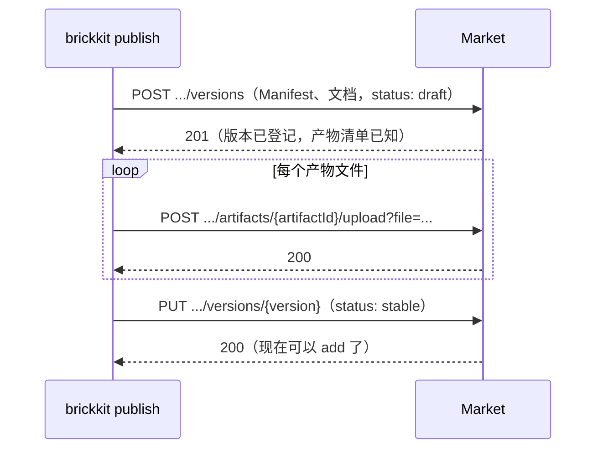

# BrickKit — 第 10 份，共 10 份 (中文)

包含: docs/zh/11-reference/01-component-yaml-schema.md, docs/zh/11-reference/02-brickkit-yaml-schema.md, docs/zh/11-reference/03-deploy-yaml-schema.md, docs/zh/11-reference/04-config-schema-spec.md, docs/zh/11-reference/05-json-schemas.md, docs/zh/11-reference/06-market-api.md

下面 File 与包含里的路径都相对仓库根目录 https://raw.githubusercontent.com/brickKit/brickKit/main/ ；页内链接相对这份合集自己

这是最后一份。

---

> File: docs/zh/11-reference/01-component-yaml-schema.md

# component.yaml 字段参考

组件的 Manifest 的每一个字段：类型、是否必填、缺省值、校验器真正套用的规则。怎么写好每一块，见 [component.yaml 字段指南](../../docs/zh/03-component-guide/02-component-yaml-reference.md)。

文件里只能写这里列出的字段：写了不认识的字段，当场报错并提示是不是拼错了。没有扩展字段的机制。

## 顶层

| 字段 | 类型 | 必填 | 规则 |
| --- | --- | --- | --- |
| `apiVersion` | 字符串 | ✅ | 只能是 `brickkit/v1` |
| `kind` | 字符串 | ✅ | 只能是 `Component` |
| `tags` | 字符串列表 | | 检索用的标签，平台不解释 |

## metadata

| 字段 | 类型 | 必填 | 规则 |
| --- | --- | --- | --- |
| `metadata.id` | 字符串 | ✅ | `<scope>/<name>`；每段是小写字母、数字、中划线，以字母或数字开头结尾（`^[a-z0-9]([a-z0-9-]*[a-z0-9])?/[a-z0-9]([a-z0-9-]*[a-z0-9])?$`）；最长 63 个字符（版本化服务名要符合 DNS 标签规则） |
| `metadata.name` | 字符串 | ✅ | 给人看的名字 |
| `metadata.version` | 字符串 | ✅ | 精确版本 `主.次.修订`（`^\d+\.\d+\.\d+$`），不接受 `v` 前缀、范围与 `latest` |
| `metadata.description` | 字符串 | ✅ | 一句话描述 |
| `metadata.vendor` | 字符串 | | 发布者 |
| `metadata.license` | 字符串 | | 许可证 |
| `metadata.apiDocs` | 字符串 | | API 文档地址 |
| `metadata.repository` | 字符串 | | 组件仓库或主页的地址；项目 `AGENTS.md` 的组件表链到这里 |

## artifacts

契约与其它随组件发布的文件。每一项：

| 字段 | 类型 | 必填 | 规则 |
| --- | --- | --- | --- |
| `artifacts[].type` | 字符串 | ✅ | 自由字符串，平台不解释（如 `api-contract`） |
| `artifacts[].files` | 字符串列表 | ✅ | 至少一个；相对仓库根的路径，不能是绝对路径、不能用 `..` 走出仓库 |
| `artifacts[].format` | 字符串 | | 自由字符串（如 `openapi`、`protobuf`） |
| `artifacts[].description` | 字符串 | | 给人看的说明 |

## dependencies

| 字段 | 类型 | 必填 | 规则 |
| --- | --- | --- | --- |
| `dependencies.components[].id` | 字符串 | ✅ | `<组件ID>@<精确版本>`。也可以整项直接写成这个字符串（强依赖的简写） |
| `dependencies.components[].optional` | 布尔 | | `true` 为弱依赖；缺省为强依赖 |

两种写法：

```yaml
dependencies:
  components:
    - demo/hello@1.1.0
    - id: demo/bus@1.0.0
      optional: true
```

规则：版本必须是精确版本；不能依赖自己；同一个组件 ID 只能出现一次（地址变量名不带版本，两个版本会撞在同一个变量上）。

## configSchema

| 字段 | 类型 | 必填 | 规则 |
| --- | --- | --- | --- |
| `configSchema.type` | 字符串 | | 写的话是 `object` |
| `configSchema.required` | 字符串列表 | | 每一项必须在 `properties` 里声明过 |
| `configSchema.properties.<key>.type` | 字符串 | ✅ | `string` / `integer` / `number` / `boolean` / `array` / `object` |
| `configSchema.properties.<key>.default` | 任意 | | 缺省值；标量按写的原样注入（`1.10` 还是 `1.10`），列表与映射注入时编码成一行 JSON |
| `configSchema.properties.<key>.description` | 字符串 | | 出现在使用方配置骨架的行尾 |
| `configSchema.properties.<key>.secret` | 布尔 | | `true` 时这一项按密钥处理（Docker 进 0600 的 env 文件，K8s 进 Secret） |
| `configSchema.properties.<key>.mount` | 字符串 | | 只有 `file` 一个取值：值写成文件挂进容器，这个键的环境变量里是文件路径。要求同一项 `secret: true` 且 `type: string`。见 [以文件交付](../../docs/zh/01-three-layers/07-sensitive-values.md#以文件交付mount-file) |
| `configSchema.properties.<key>.enum` | 列表 | | 允许的取值——**只是说明，平台不检查值** |
| `configSchema.properties.<key>.minimum` | 数字 | | 同上 |
| `configSchema.properties.<key>.maximum` | 数字 | | 同上 |
| `configSchema.properties.<key>.pattern` | 字符串 | | 同上 |
| `configSchema.properties.<key>.items.type` | 字符串 | | `array` 类型的元素类型；同上 |

`<key>` 就是注入的环境变量名：必须是合法的环境变量名（字母、数字、下划线，不以数字开头），原样注入，不做大小写转换。
撞上平台保留的名字（`COMPONENT_ID`、`COMPONENT_VERSION`、`PORT`、`BRICKKIT_SERVED_MEMBERS`、`BRICKKIT_SERVED_MEMBERS_CONFIG`、`*_ENDPOINT`）时：
`up` / `lint` 警告并忽略这一项，市场拒收。平台只检查键名、不检查值，详见 [configSchema 规格](../../docs/zh/11-reference/04-config-schema-spec.md)。

## deployment

| 字段 | 类型 | 必填 | 规则 |
| --- | --- | --- | --- |
| `deployment.type` | 字符串 | ✅ | 只能是 `container` |
| `deployment.image` | 字符串 | 二选一 | 预构建镜像；不带 tag 时补上 `metadata.version` |
| `deployment.build.context` | 字符串 | 二选一 | 构建上下文，相对仓库根，缺省 `.` |
| `deployment.build.dockerfile` | 字符串 | | Dockerfile 路径，相对仓库根，缺省 `Dockerfile` |
| `deployment.port` | 整数 | ✅ | 主端口，1–65535 |
| `deployment.protocol` | 字符串 | | 主端口上说的协议：`http` / `grpc` / `tcp`。只有 K8s 用它（写成 Service 端口的 `appProtocol`）；不改变注入的地址 |
| `deployment.extraPorts[].name` | 字符串 | ✅ | 小写字母、数字、中划线，最长 15 个字符（K8s Service 端口名规则）；不能重复。调用方拿到的地址变量是 `<ID>_<名字>_ENDPOINT`，`-` 换成 `_`（`demo/hello` 的 `admin-api` → `DEMO_HELLO_ADMIN_API_ENDPOINT`） |
| `deployment.extraPorts[].port` | 整数 | ✅ | 1–65535，不能与主端口相同 |
| `deployment.extraPorts[].protocol` | 字符串 | | 这个端口上说的协议：`http` / `grpc` / `tcp`，含义同 `deployment.protocol` |
| `deployment.resources.requests.cpu` | 字符串 | | 建议的 CPU 请求，如 `"100m"` |
| `deployment.resources.requests.memory` | 字符串 | | 建议的内存请求，如 `"128Mi"` |
| `deployment.resources.limits.cpu` | 字符串 | | 建议的 CPU 上限（建议不写） |
| `deployment.resources.limits.memory` | 字符串 | | 建议的内存上限 |
| `deployment.stopGracePeriodSeconds` | 整数 | | 收到停止信号（SIGTERM）后需要多少秒把手上的事做完，1–3600；Docker / Podman 写成 `stop_grace_period`，K8s 写成 `terminationGracePeriodSeconds`，本机进程等这么久再强杀。不写用引擎的默认值（compose 10 秒、K8s 30 秒）；部署条目可以覆盖 |
| `deployment.labels` | 字符串映射 | | 原样透传：Docker 写成 service labels，K8s 写成 Deployment 与其 Pod 的 annotations；值必须是字符串 |

`image` 与 `build` 至少写一个；`build` 的路径必须在仓库里。`resources` 写了的话，`requests` 或 `limits` 里至少要有 `cpu` 或 `memory` 之一；
这里的值是作者的建议，使用方在部署文件的条目上逐字段覆盖。只有 `requests` 有平台缺省值（`100m` / `128Mi`），`limits` 没有缺省值。

## migration

| 字段 | 类型 | 必填 | 规则 |
| --- | --- | --- | --- |
| `migration.command` | 字符串列表 | ✅（写了 `migration` 时） | 迁移命令，数组形式；用同一个镜像执行 |

## healthCheck

| 字段 | 类型 | 必填 | 规则 |
| --- | --- | --- | --- |
| `healthCheck.type` | 字符串 | ✅ | `http` / `tcp` / `none` |
| `healthCheck.path` | 字符串 | `http` 时必填 | 以 `/` 开头 |
| `healthCheck.startPeriodSeconds` | 整数 | | 启动宽限期，单位秒，缺省 60，最大 3600；`type: none` 时不能写 |
| `readinessCheck.type` | 字符串 | 写了 `readinessCheck` 时 ✅ | 就绪检查：`http` / `tcp`（没有 `none`：不需要就整个不写）。不写 `readinessCheck` 时就绪也看 `healthCheck`。K8s 的 readinessProbe 与 Docker / Podman 的 healthcheck 用它，K8s 的存活、启动探针仍用 `healthCheck` |
| `readinessCheck.path` | 字符串 | `type: http` 时 ✅ | 主端口上的就绪路径，以 `/` 开头 |

检查间隔 10 秒、超时 3 秒、连续 3 次失败算不健康，由平台固定，不可配置。

每种类型实际跑什么：Docker 下检查在容器里经由 `/bin/sh` 执行——`http` 先用 `wget`、不行再用 `curl` 访问 `http://127.0.0.1:<端口><路径>`，
`tcp` 执行 `nc -z 127.0.0.1 <端口>`，所以镜像里要有 shell 和这些工具（`scratch`、distroless 这类没有 shell 的镜像两种都过不了）。
K8s 下它们变成 `httpGet` / `tcpSocket` 探针，从容器外面发起。`none` 不生成检查：依赖方只等容器启动。
见 [组件日志正常，平台却说它不健康](../../docs/zh/10-troubleshooting/01-up-down-issues.md#组件日志正常平台却说它不健康)。

## shell

| 字段 | 类型 | 必填 | 规则 |
| --- | --- | --- | --- |
| `shell.members` | 字符串列表 | ✅（写了 `shell` 时） | 外壳编进的成员，每项 `<组件ID>@<精确版本>`；至少一项；不能是自己；同一个组件只能列一个版本 |

写了 `shell`，这个组件就是外壳；项目的 `brickkit.yaml` 里它的条目必须带 `kind: shell`。见 [外壳声明](../../docs/zh/04-shell/03-shell-declaration.md)。

## events

| 字段 | 类型 | 必填 | 规则 |
| --- | --- | --- | --- |
| `events.publishes` | 字符串列表 | | 组件发布的事件名。每项字母或数字开头，其后是字母、数字与 `.` `_` `/` `:` `-`；不带通配符；不能重复 |
| `events.subscribes` | 字符串列表 | | 组件订阅的事件：事件名（同上），或以 `*` 结尾的前缀（`orders.*`；单独一个 `*` 是全部事件）；不能重复。`>` `#` `+` 和写在中间的 `*` 不接受 |

只用于 `graph`、`deps` 与 `lint` 的展示和提示，不影响部署：订阅项与某个事件名完全相等，或以 `*` 结尾且事件名以它前面那一段开头，就算收得到。
见 [events：我发布、订阅哪些事件](../../docs/zh/03-component-guide/02-component-yaml-reference.md#events我发布订阅哪些事件)。

## local

组件以 `mode: local` 运行时，BrickKit 怎么启动它、怎么跑它的迁移。启动命令多数情况下从源码目录里的标记文件自动认出；从源码运行的迁移从不靠猜。

| 字段 | 类型 | 必填 | 规则 |
| --- | --- | --- | --- |
| `local.language` | 字符串 | | `go` / `rust` / `dotnet` / `node` / `java` / `python` / `ruby`；同一目录里有好几种语言的标记文件时用它指明 |
| `local.runCommand` | 字符串列表 | | 直接给出启动命令；第一项含路径分隔符时相对组件目录 |
| `local.migrationCommand` | 字符串列表 | | 从源码运行的 `migration.command`，写法同 `runCommand`；要先有 `migration`。`mode: local` 时 `up` 在启动进程之前跑它，失败就不启动进程；在本机运行的外壳对从本地仓库编进去的成员也这样做。带着代码（`deployment.build`）、有 `migration` 却没写它的组件，`lint` 会警告。见[不跑迁移容器的情况](../../docs/zh/05-migration/01-migration-service.md#不跑迁移容器的情况) |

## release

`brickkit release` 与 `brickkit publish` 发布一个版本之前要跑的东西。

| 字段 | 类型 | 必填 | 规则 |
| --- | --- | --- | --- |
| `release.checks` | 字符串列表的列表 | ✅（写了 `release` 时） | 要按顺序跑的命令；每条是一个数组——程序，然后是参数——不能有空项；第一项含路径分隔符时相对组件目录 |

每条都在组件目录下执行，不经过 shell，环境变量用终端里的那一份；第一条非零退出就停止发布（`RELEASE_CHECK_FAILED`），
`--skip-checks` 不跑它们。全部通过之后，`release` 还要确认它们没有改动组件目录——没有未提交的改动、当前提交没变——
否则拒绝发布（`RELEASE_BLOCKED`）。`add`、`fetch`、`up` 从不执行它。见[发布](../../docs/zh/03-component-guide/07-release-workflow.md#你自己的检查releasechecks)。

---

> File: docs/zh/11-reference/02-brickkit-yaml-schema.md

# brickkit.yaml 字段参考

项目用哪些组件、各是哪个精确版本、从哪里取。它是项目的锁文件。怎么用，见 [brickkit.yaml](../../docs/zh/01-three-layers/02-brickkit-yaml.md)。

写了不认识的字段当场报错。部署方式（`mode`、`expose`……）不写在这里，写在部署文件里。

## 顶层

| 字段 | 类型 | 必填 | 规则 |
| --- | --- | --- | --- |
| `project` | 字符串 | ✅ | 小写字母、数字、中划线，以字母或数字开头结尾（`^[a-z0-9]([a-z0-9-]*[a-z0-9])?$`）；最长 54 个字符（K8s 命名空间最长 63，减去 CLI 加的 `brickkit-` 前缀）。它成为 Docker 网络、Compose 项目与 K8s 命名空间的名字 |

## sources

安装源：去哪里找组件。按声明顺序依次尝试，第一个有这个组件的源说了算。

| 字段 | 类型 | 必填 | 规则 |
| --- | --- | --- | --- |
| `sources[].name` | 字符串 | ✅ | 安装源的名字，在这份文件里唯一 |
| `sources[].type` | 字符串 | ✅ | `git` / `local` / `market` |
| `sources[].baseUrl` | 字符串 | `git` 时与 `repo` 二选一 | 组件 `<scope>/<name>` 的仓库是 `<baseUrl>/<scope>-<name>`（`baseUrl` 末尾的 `/` 可写可不写，CLI 只补一个）；不能以 `-` 开头 |
| `sources[].repo` | 字符串 | `git` 时与 `baseUrl` 二选一 | 一个在子目录里放着多个组件的仓库（monorepo）：版本是 tag `<scope>-<name>/<版本>`，组件的子目录是那个 tag 里 `component.yaml` 的 `metadata.id` 是它的那一个；不能以 `-` 开头 |
| `sources[].path` | 字符串 | `local` 必填 | 本机目录，相对项目根；里面按 `<scope>/<name>/component.yaml` 摆放 |
| `sources[].url` | 字符串 | `market` 必填 | 组件市场的 API 地址 |
| `sources[].authToken` | 字符串 | | 市场令牌，通常写 `${VAR}`；已 `brickkit login` 时优先用登录凭据 |
| `sources[].enabled` | 布尔 | | 缺省 `true`；`false` 时这个源不参与查找 |

## components

每个组件版本一个条目。

| 字段 | 类型 | 必填 | 规则 |
| --- | --- | --- | --- |
| `components[].id` | 字符串 | ✅ | 组件 ID，规则同 `component.yaml` 的 `metadata.id` |
| `components[].version` | 字符串 | ✅ | 精确版本。本地源的组件也写 `component.yaml` 里的真实版本 |
| `components[].kind` | 字符串 | | 只能是 `shell` 或不写；由 CLI 在 `add` 外壳时写上，必须与组件的 `shell` 块一致；同一个组件 ID 的所有版本一致 |
| `components[].requiredBy` | 字符串列表 | | 这个版本因哪些组件依赖而留下（兼容版本）；每一项必须是这份文件里的组件 ID，不能是自己 |
| `components[].source.type` | 字符串 | ✅（写了 `source` 时） | `git` / `local` |
| `components[].source.repo` | 字符串 | `git` 必填 | 这个组件的仓库地址（推导不出来、或在别的组织时） |
| `components[].source.path` | 字符串 | `local` 必填 | `local`：组件目录，相对项目根；`git`：组件在仓库里的子目录（monorepo），不能是绝对路径、不能走出仓库 |

版本之间的规则：

- 同一个组件版本只能出现一次。
- 同一个组件 ID 有几个版本时，**恰好一个**不写 `requiredBy`——它是默认版本；其余都写 `requiredBy`。
- 外壳在一个项目里只能有一个版本，也就不能写 `requiredBy`。
- 同一个组件的几行，`source` 必须写得一样（一个组件只有一个仓库）。

## installer

组件市场签名的校验设置。只对来自市场的组件生效。

| 字段 | 类型 | 必填 | 规则 |
| --- | --- | --- | --- |
| `installer.requireSignature` | 布尔 | | 缺省 `true`：没有签名的市场组件不安装 |
| `installer.publicKeys` | 字符串映射 | | 信任的发布者公钥：公钥名（签名里的 `publicKeyRef`）→ 公钥文件路径（相对项目根）。**一把都没配时签名校验完全关闭** |

见 [安全与签名](../../docs/zh/06-architecture/08-security-and-signing.md)。

---

> File: docs/zh/11-reference/03-deploy-yaml-schema.md

# 部署文件字段参考

`deploy.yaml`、`deploy.local.yaml`、`deploy.<环境>.yaml` 是同一种结构。怎么用，见 [deploy.yaml](../../docs/zh/01-three-layers/03-deploy-yaml.md) 与 [deploy.local.yaml](../../docs/zh/01-three-layers/04-deploy-local-yaml.md)。

写了不认识的字段当场报错。只对另一种部署目标有用的字段不报错，会警告"在 target: … 下不起作用，已忽略"——换目标时它们生效。

## 顶层

| 字段 | 类型 | 必填 | 规则 |
| --- | --- | --- | --- |
| `target` | 字符串 | ✅ | `docker` / `podman` / `k8s` |
| `focus` | 字符串 | | 只能写在 `deploy.local.yaml` 里：一个组件 ID。只有这个组件和它需要的组件启动，它从源码跑（按 `mode: local`，写了 `mode: debug` 就按 debug）；`target: k8s` 下不能用。见[在项目里就地开发](../../docs/zh/02-project-guide/04-focus-run.md) |
| `network` | 字符串 | | 只对 Docker / Podman：项目自己提供的网络名。写了就加入这个已存在的网络（生成的 compose 标成 `external`），不再建 `brickkit-<项目名>-net`，`down` 也不删它；`up` 之前核对它存在。K8s 下写了只警告 |
| `vars` | 映射 | | 覆盖 `config/vars.yaml` 里的同名公共变量，只影响 `$var:` 的查找；键必须是合法的环境变量名 |

## k8s

项目级的 Kubernetes 设置。`target` 不是 `k8s` 时写了会被警告、忽略。

| 字段 | 类型 | 必填 | 规则 |
| --- | --- | --- | --- |
| `k8s.context` | 字符串 | | 部署到哪个 kubeconfig 上下文。写了之后，`up`（真正部署前）、`down`、`status` 先确认 `kubectl` 当前连着的就是它；读不到当前上下文时放行 |
| `k8s.namespace` | 字符串 | | 缺省 `brickkit-<项目名>`；规则同项目名 |
| `k8s.createNamespace` | 布尔 | | 缺省 `true`；只有命名空间级权限时写 `false` |
| `k8s.podSecurity` | 字符串 | | 只能是 `restricted`：给每个容器生成 restricted 级别的 `securityContext` |
| `k8s.imagePullSecrets` | 字符串列表 | | 拉镜像用的 Secret 名 |
| `k8s.ingressClass` | 字符串 | | Ingress 的 class |
| `k8s.ingressAnnotations` | 字符串映射 | | 原样写到每个 Ingress 上 |
| `k8s.appProtocols` | 字符串映射 | | 把组件声明的端口协议换成这个集群认的 `appProtocol` 写法：键是 `http` / `grpc` / `tcp`，值是 `grpc`、`kubernetes.io/h2c` 这样的名字。没写的协议原样写；组件没声明协议的端口不写 `appProtocol` |
| `k8s.serviceAccount.enabled` | 布尔 | | `true` 时每个组件一个 ServiceAccount，不挂载令牌 |
| `k8s.networkPolicy.enabled` | 布尔 | | `true` 时按依赖图为每个组件生成 NetworkPolicy |
| `k8s.networkPolicy.ingressController.namespace` | 字符串 | 见规则 | Ingress 控制器所在的命名空间；开了网络策略、又有 `expose: true` 的组件时必填 |
| `k8s.networkPolicy.ingressController.podSelector` | 字符串映射 | | Ingress 控制器 Pod 的标签 |
| `k8s.networkPolicy.allowFrom[].name` | 字符串 | ✅ | 这条放行给谁（写进注解，日后看得懂为什么开） |
| `k8s.networkPolicy.allowFrom[].namespace` | 字符串 | ✅ | 放行来自哪个命名空间 |
| `k8s.networkPolicy.allowFrom[].podSelector` | 字符串映射 | | 只放行那个命名空间里带这些标签的 Pod |
| `k8s.networkPolicy.allowFrom[].ports` | 整数列表 | | 只放行这些端口（1–65535） |
| `k8s.networkPolicy.egress.enabled` | 布尔 | | `true` 时也生成出站策略：依赖图里的依赖与 DNS 自动放行，其余一律拒绝 |
| `k8s.networkPolicy.egress.allowTo[].name` | 字符串 | ✅ | 这个出站目标是什么（如 `main-db`） |
| `k8s.networkPolicy.egress.allowTo[].namespace` | 字符串 | 二选一 | 集群内的目标：所在命名空间 |
| `k8s.networkPolicy.egress.allowTo[].cidr` | 字符串 | 二选一 | 集群外的目标：地址段；与 `namespace` 只能写一个 |
| `k8s.networkPolicy.egress.allowTo[].podSelector` | 字符串映射 | | 集群内目标 Pod 的标签 |
| `k8s.networkPolicy.egress.allowTo[].ports` | 整数列表 | | 只放行这些端口 |

开出站策略时，数据库这类外部服务要自己写进 `allowTo`：平台只知道依赖图里的组件，不认识 `config/` 里的一串地址。

## components

每个组件版本恰好一个条目，与 `brickkit.yaml` 一一对应（外壳成员的条目嵌在外壳下面，同样算）。

| 字段 | 类型 | 必填 | 规则 |
| --- | --- | --- | --- |
| `components[].id` | 字符串 | ✅ | 裸 ID 指默认版本；`<组件ID>@<版本>` 指那个版本（兼容版本必须这样写） |
| `components[].mode` | 字符串 | | `enabled` / `disable` / `local` / `debug`。不写就跟着上层走：依赖它的组件里只要有一个在跑，它就跑（顶层组件缺省就跑）。`debug` 只能写在 `deploy.local.yaml`；`local`、`debug` 在 `target: k8s` 下不允许 |
| `components[].localPort` | 整数 | | 本机进程监听的端口，1–65535；只在 `mode: local` / `mode: debug` 下，或在 `focus` 组件的条目上（它按 `mode: local` 跑）能写；不能与别的条目冲突。`mode: local` 不写时自动选一个 |
| `components[].expose` | 布尔 | | 对外开放：Docker 映射宿主机端口，K8s 生成 Ingress |
| `components[].exposePort` | 整数 | | Docker 下映射到的宿主机端口，缺省等于组件端口；只在 `expose: true` 时能写；不能冲突；K8s 下忽略 |
| `components[].hostname` | 字符串 | 见规则 | Ingress 的域名；`target: k8s` 且 `expose: true` 时必填 |
| `components[].tlsSecret` | 字符串 | | Ingress 的 TLS 证书 Secret；只在 `expose: true` 时能写 |
| `components[].paths` | 字符串列表 | | 这个组件在 `hostname` 下接的路径前缀（`/api/sales`）；不写是整个域名。每项以 `/` 开头，各段用字母、数字和 `.` `_` `~` `-`，不认通配符和正则；只在 `expose: true` 时能写。同一个域名下一条路径只能归一个组件，共用域名的条目 `tlsSecret` 要相同 |
| `components[].replicas` | 整数 | | K8s 副本数，缺省 1，必须 ≥ 1；大于 1 时自动生成 PodDisruptionBudget；不能与 `mode: local` / `debug` 同时写。要关掉组件用 `mode: disable` |
| `components[].serviceAccountName` | 字符串 | | K8s 下用一个已有的 ServiceAccount（平台只引用，不创建） |
| `components[].resources.requests.cpu` | 字符串 | | 覆盖组件建议的配额，逐字段 |
| `components[].resources.requests.memory` | 字符串 | | 同上 |
| `components[].resources.limits.cpu` | 字符串 | | 同上 |
| `components[].resources.limits.memory` | 字符串 | | 同上 |
| `components[].labels` | 字符串映射 | | 逐键覆盖组件 `deployment.labels`，原样透传 |
| `components[].stopGracePeriodSeconds` | 整数 | | 覆盖组件 `deployment.stopGracePeriodSeconds` 推荐的停机宽限期，1–3600 秒 |
| `components[].skipWaitFor` | 字符串列表 | | 启动时不等这些强依赖（写不带版本的组件 ID）；必须是这个组件版本真实的强依赖；不能是自己、不能重复。Docker / Podman 容器专用，K8s 与本机进程下忽略 |

配额的优先级：部署文件的 `resources` > 组件 `deployment.resources` > 平台缺省（只有 `requests`：`100m` / `128Mi`）。

### 外壳的成员：`components[].members`

外壳条目下面可以嵌 `members`，每个成员是一个完整的部署条目，字段与上表相同，只嵌一层：

| 字段 | 类型 | 必填 | 规则 |
| --- | --- | --- | --- |
| `components[].members[].id` | 字符串 | ✅ | 裸 ID 或 `id@版本`；不能是外壳自己；一个外壳里一个组件只能有一个版本 |
| `components[].members[].mode` | 字符串 | | 同 `components[].mode`；`debug` / `local` 时这个成员这次以本机进程运行，外壳不承载它 |
| `components[].members[].localPort` | 整数 | | 同上 |
| `components[].members[].stopGracePeriodSeconds` | 整数 | | 同上；外壳承载时不生效（外壳用自己的值），成员回落成独立组件时生效 |
| `components[].members[].skipWaitFor` | 字符串列表 | | 同上 |
| `components[].members[].expose` | 布尔 | | 外壳承载时不生效，外壳不跑时生效 |
| `components[].members[].exposePort` | 整数 | | 同上 |
| `components[].members[].hostname` | 字符串 | | 同上 |
| `components[].members[].tlsSecret` | 字符串 | | 同上 |
| `components[].members[].paths` | 字符串列表 | | 同上 |
| `components[].members[].replicas` | 整数 | | 同上 |
| `components[].members[].serviceAccountName` | 字符串 | | 同上 |
| `components[].members[].labels` | 字符串映射 | | 同上 |
| `components[].members[].resources.requests.cpu` | 字符串 | | 同上 |
| `components[].members[].resources.requests.memory` | 字符串 | | 同上 |
| `components[].members[].resources.limits.cpu` | 字符串 | | 同上 |
| `components[].members[].resources.limits.memory` | 字符串 | | 同上 |

只有外壳（`brickkit.yaml` 里 `kind: shell`）的条目能写 `members`，放在下面的成员必须是外壳 `component.yaml` 里编进了的组件。见 [成员管理](../../docs/zh/04-shell/04-members-management.md)。

## 只对某种目标生效的字段

| 只在 | 字段 | 在另一种目标下 |
| --- | --- | --- |
| k8s | `k8s` 块、`replicas`、`hostname`、`tlsSecret`、`paths`、`serviceAccountName` | 警告、忽略 |
| docker、podman | `exposePort`、`skipWaitFor` | 警告、忽略 |
| docker、podman | `mode: local`、`mode: debug` | `k8s` 下报错（集群里的 Pod 到不了你的机器） |

---

> File: docs/zh/11-reference/04-config-schema-spec.md

# configSchema 规格

`configSchema` 是组件 `component.yaml` 里的一块，声明这个组件认哪些配置项。它的写法借用 JSON Schema（draft-07）的一个子集：一个 `type: object`，
`properties` 列出每一项，`required` 列出必填项。设计上怎么拆、怎么命名，见 [configSchema 设计准则](../../docs/zh/03-component-guide/03-config-schema-design.md)。

## 结构

```yaml
configSchema:
  type: object
  properties:
    DB_HOST:
      type: string
      description: PostgreSQL 主机名
    DB_PORT:
      type: integer
      default: 5432
      minimum: 1
      maximum: 65535
      description: PostgreSQL 端口
    DB_PASSWORD:
      type: string
      secret: true
      description: 连接口令
    REGIONS:
      type: array
      items:
        type: string
      default: [cn-east, cn-north]
      description: 服务的区域
  required: [DB_HOST, DB_PASSWORD]
```

| 写法 | 含义 |
| --- | --- |
| `properties` 的键 | 配置项名，也就是注入的环境变量名，原样注入：必须是合法的环境变量名（字母、数字、下划线，不以数字开头） |
| `type` | `string` / `integer` / `number` / `boolean` / `array` / `object` |
| `default` | 没写值时用它；标量按写的原样注入成字符串（`default: 1.10` 注入的是 `1.10`，不是 `1.1`），`array` / `object` 注入成一行 JSON |
| `description` | 出现在使用方配置骨架的行尾 |
| `secret: true` | 这一项是密钥：部署时走密钥通道，从不明文写进部署文件 |
| `mount: file` | 这一项以文件交付：环境变量里是文件的路径（`/run/brickkit/secrets/<服务名>/<键>`），值在文件里。只能和 `secret: true`、`type: string` 一起写 |
| `required` | 必填项；每一项必须在 `properties` 里声明过 |
| `enum`、`minimum`、`maximum`、`pattern`、`items` | 允许的取值——**只是说明** |

每一项字段的精确规则见 [component.yaml 字段参考](../../docs/zh/11-reference/01-component-yaml-schema.md#configschema)。

## 平台只检查键名，不检查值

这是 `configSchema` 最重要的一条规则。

**键名**，平台查：

| 情况 | 结果 |
| --- | --- |
| `config/` 里写了一个 `configSchema` 里没有的键 | 警告"不会生效"，并猜你想写哪个 |
| 组件没有 `configSchema`，`config/` 里却写了配置 | 警告：整份配置都不会生效 |
| `required` 里的项没有 `default`、`config/` 里也没填 | `up` 拒绝启动，点名缺哪一项 |
| 键名撞上平台保留的名字 | `up` / `lint` 警告并忽略这一项；市场拒收 |

**值**，平台不查：`type: integer` 的项填了 `"abc"`、`enum` 之外的值、超出 `maximum` 的数，平台都照常注入。

分界线在于有没有运行时的安全网。值写错了，组件读它的时候就会失败（解析不了、校验不过），你一定会发现，而且怎么处理错值是组件自己的决定。
键名写错了，变量根本不存在，组件走它的缺省分支照常运行——没有任何东西会失败，配置只是悄悄没生效。这类错误只有平台能发现，所以平台只查这一类。

而一旦开始校验值就停不下来：类型、枚举、范围、正则、嵌套结构……JSON Schema 的能力几乎无穷，每多查一样，平台就多替组件做一个决定。

所以组件要自己在启动时校验值：

```go
port, err := strconv.Atoi(os.Getenv("DB_PORT"))
if err != nil || port < 1 || port > 65535 {
	log.Fatalf("DB_PORT must be a port number, got %q", os.Getenv("DB_PORT"))
}
```

## 与 JSON Schema 的关系

写法与 JSON Schema 兼容，但它不是被当作 JSON Schema 去**执行**的：CLI 读的只有 `properties` 的键、`type`、`default`、`required`、`secret`、`description`；
其余关键字原样保存、给人读。某一项里写了这里没列出的关键字（拼错的 `defualt`，或照 JSON Schema 习惯写的 `format`、`examples`、`oneOf`……），
解析时会被丢掉——它们不会生效。作者在自己听得到、改得动的地方会收到警告（`lint`、本地源扫描、`publish`）；安装别人的组件时不因此失败，
因为使用方改不了别人的 Manifest。

## 编辑器

`schemas/component.schema.json` 描述了 `configSchema` 这一块的结构，接进编辑器之后，写 `configSchema` 时有补全、写错关键字（`defualt`）立刻标红。
见 [JSON Schema](../../docs/zh/11-reference/05-json-schemas.md)。`lint` 也会报出 `configSchema` 某一项里拼错的键：

```text
警告：configSchema 里有配置项声明的键不会生效
```

---

> File: docs/zh/11-reference/05-json-schemas.md

# JSON Schema

## `schemas/` 目录

仓库的 `schemas/` 下有三份 JSON Schema（draft-07），描述三种文件的结构：

| 文件 | 描述 |
| --- | --- |
| `schemas/component.schema.json` | 组件的 `component.yaml` |
| `schemas/brickkit.schema.json` | 项目的 `brickkit.yaml` |
| `schemas/deploy.schema.json` | 部署文件：`deploy.yaml`、`deploy.local.yaml`、`deploy.<环境>.yaml` |

它们是从 CLI 的 Go 结构体生成的，不是手写的：结构体改了，重新生成、一起提交；`make lint`（其中的 `check-schemas`，每次发布前也会跑）拦住"改了结构体却忘了重新生成"。
所以 schema 里的字段与 CLI 真正接受的字段逐一对应。

## 接进编辑器

装了 YAML 语言服务的编辑器（VS Code 的 Red Hat YAML 扩展、JetBrains 系列、Neovim 的 yaml-language-server……）接上 schema 之后：
字段名有补全，类型不对、必填字段没写、拼错的字段名立刻标红——与 `brickkit lint` 报的是同一批结构问题，只是在你打字的时候就看到。

**方法一：文件顶部加一行注释。** 对单个文件生效，谁打开都一样：

```yaml
# yaml-language-server: $schema=https://raw.githubusercontent.com/brickKit/brickKit/main/schemas/deploy.schema.json
target: docker
components:
  - id: demo/hello
```

`component.yaml` 用 `component.schema.json`，`brickkit.yaml` 用 `brickkit.schema.json`。

**方法二：编辑器设置里按文件名映射。** VS Code 的 `settings.json`：

```json
{
  "yaml.schemas": {
    "https://raw.githubusercontent.com/brickKit/brickKit/main/schemas/component.schema.json": "component.yaml",
    "https://raw.githubusercontent.com/brickKit/brickKit/main/schemas/brickkit.schema.json": "brickkit.yaml",
    "https://raw.githubusercontent.com/brickKit/brickKit/main/schemas/deploy.schema.json": ["deploy.yaml", "deploy.*.yaml"]
  }
}
```

放进项目的 `.vscode/settings.json`，整个团队打开项目就都有。想固定在某个 CLI 版本上，把 URL 里的 `main` 换成那个版本的 tag，或者指向本地的一份副本。

## 覆盖什么，不覆盖什么

JSON Schema 只描述**单个文件的结构**：字段名、类型、必填、固定的取值（`target` 只能是 `docker` / `podman` / `k8s` 这类）。

不覆盖的，归别的检查：

| 规则 | 谁查 |
| --- | --- |
| 字段之间的组合（`localPort` 要配 `mode`、`exposePort` 要配 `expose`、`mode: debug` 只能在 `deploy.local.yaml`） | `brickkit lint` |
| 配置项撞上平台保留的名字、`configSchema` 某一项里的笔误 | `brickkit lint` |
| 三层文件之间对不对得上（每个组件版本一个部署条目、`$var:` 有定义、`config/` 的键在 `configSchema` 里） | `brickkit lint` |
| 依赖能不能解析、外壳承载的成员版本对不对 | `brickkit up --dry-run` |
| `config/*.yaml` 里的配置值 | 没有 schema：每个组件的配置项不同，由它自己的 `configSchema` 决定，`lint` 按它检查键名 |

编辑器里不红，不等于 `lint` 能过；`lint` 能过，也不等于 `up --dry-run` 能过——三者一层比一层查得多。

---

> File: docs/zh/11-reference/06-market-api.md

# Market API 参考

BrickKit Market（组件市场）的 HTTP 接口。这里列的是**已经实现的端点**，与服务端的路由注册表逐条对应——`market-server` 里有测试守着：这张表多写一个不存在的端点、或者漏写一个存在的端点，测试都会失败。

平常用不着直接调这些接口：`brickkit login`、`publish`、`add`、`fetch` 已经把它们包好了。这篇写给要自己写市场客户端、或者想弄清市场某个行为细节的人。

## 市场是可选的

市场是一种**安装源**，不是 BrickKit 运行所必需的东西。一个项目只用本地源和 git 源，就能装组件、部署、升级：

- **git 源**：组件仓库打上版本 tag 就算发布了。组件在仓库根目录时 tag 就是版本号（`1.2.0`）；组件在仓库的子目录 `<scope>-<name>/` 里时，tag 是 `<scope>-<name>/1.2.0`。`brickkit release` 替你检查工作区并打 tag、推送。
- **本地源**：直接读磁盘上的组件目录，开发时用。

市场在这之上多给了几样 git 做不到、或做起来很别扭的东西：

| 市场提供的 | 为什么 git 源给不了 |
| --- | --- |
| 搜索、按标签浏览 | git 只能按仓库地址取，不知道"有哪些组件" |
| 私有组件与按用户、组织授权 | git 的权限是整个仓库级别的，与组件无关 |
| 闭源分发：只交镜像和接口契约，不交源码 | git 源装组件要读仓库本身 |
| 发布者签名的存放与转交 | git tag 上没有地方挂 BrickKit 的签名 |
| 事后下架（`blocked`）：已发布的坏版本不能再被安装 | 删掉 git tag 挡不住已经克隆过的人，也没人会收到说明 |

没有市场时一切照常；需要上面这些时再自己部署一套（或者用团队已经在跑的那套）。BrickKit 没有官方运营的公共市场。

## 基础约定

**地址：** 你所用市场实例的地址，所有路径都以 `/api/v1` 开头。

**认证：** 需要认证的接口在请求头里带令牌：

```
Authorization: Bearer <令牌>
```

令牌由 `POST /api/v1/auth/login` 给出，也就是 `brickkit login` 存进 `.brickkit/credentials` 的那个值。public 组件的查询不需要认证；private 组件的一切操作、以及发布，都需要。

**响应信封：** 除了下面单独说明的文档端点，所有响应都是同一个形状：

```json
{"success": true, "data": { "...": "..." }}
```

```json
{"success": false, "error": {"code": "MANIFEST_INVALID", "message": "the Manifest failed validation", "details": { "...": "..." }}}
```

`error.details` 是结构化的补充信息（逐条的校验问题、冲突详情等），不是每个错误都有。市场的文字说明一律是英文；要按错误分流就看 `code`，它是稳定的。

## 错误码

| 错误码 | HTTP 状态 | 含义 |
| --- | --- | --- |
| `INVALID_REQUEST` | 400 | 请求体不是合法 JSON、超过 8 MiB（`details.limitBytes`），或者请求字段（来源、版本号、可见性、文档……）不合法 |
| `MANIFEST_INVALID` | 400 | 发布时提交的 Manifest 没通过校验；`details.problems` 逐条列出 |
| `CONFIG_SCHEMA_RESERVED_VARIABLE_CONFLICT` | 400 | `configSchema` 里的配置项与平台保留的环境变量同名 |
| `CLOSED_SOURCE_MISSING_API_CONTRACT` | 400 | 闭源组件没有声明 `api-contract` 产物 |
| `UNAUTHORIZED` | 401 | 没带令牌，或者令牌无效、过期 |
| `FORBIDDEN` | 403 | 令牌有效，但这个身份没有权限做这件事 |
| `COMPONENT_BLOCKED` | 403 | 组件或版本已被市场管理员下架 |
| `NOT_FOUND` | 404 | 组件、版本、组织或文档不存在 |
| `CONFLICT` | 409 | 状态冲突（比如把已在别的组织里的用户拉进来） |
| `VERSION_ALREADY_EXISTS` | 409 | 这个版本号已经用过；版本号不能重复发布，软删除的版本也继续占着号 |
| `INTERNAL` | 500 | 市场内部错误；具体原因只写进服务端日志，不对外透露 |

## 端点

### 运维与审计

| 方法 | 路径 | 认证 | 说明 |
| --- | --- | --- | --- |
| GET | `/api/v1/health` | 否 | 健康检查，返回 `status`、服务端版本号与当前时间。自托管时容器的 healthcheck 探的就是它 |
| GET | `/api/v1/audit` | 是 | 审计日志，按时间倒序。查询参数：`componentId`、`action`、`limit`。管理员看全部；其他人只看自己名下组件上的条目（包括别人的下载），以及自己做过的操作 |

### 账号

| 方法 | 路径 | 认证 | 说明 |
| --- | --- | --- | --- |
| POST | `/api/v1/auth/register` | 否 | 注册。请求体：`username`、`password`、`email`（可选） |
| POST | `/api/v1/auth/login` | 否 | 登录。请求体：`username`、`password`；响应里有 `token` 与 `expiresAt` |
| POST | `/api/v1/auth/logout` | 是 | 作废本次请求带的这个令牌（不影响同一账号的其他令牌）。重复调用不报错 |

⚠️ 注册请求里即使带了 `orgId` 也会被忽略。组织成员身份就是读取组织私有组件的凭据，能自报组织就等于谁都能读别人的私有组件。加入组织只有一条路：由组织所有者或市场管理员调下面的"添加成员"。

### 组织

| 方法 | 路径 | 认证 | 说明 |
| --- | --- | --- | --- |
| GET | `/api/v1/organizations` | 是 | 组织列表。普通用户只看得到自己所在的那个，管理员看得到全部 |
| POST | `/api/v1/organizations` | 是 | 创建组织，创建者成为所有者并自动入组 |
| POST | `/api/v1/organizations/{orgId}/members` | 是（组织所有者或管理员） | 添加成员 |

一个用户最多属于一个组织。把已在别的组织里的人加进来会返回 `CONFLICT`，而不是悄悄把他挪走——那样他原来组织的私有组件会突然读不到。重复添加同一个人不报错。

### 组件

| 方法 | 路径 | 认证 | 说明 |
| --- | --- | --- | --- |
| GET | `/api/v1/components` | 视可见性 | 搜索。查询参数：`keyword`、`page`、`pageSize`、`tags`（逗号分隔，也可以重复传）。只返回没被下架、且调用者看得到的组件 |
| GET | `/api/v1/components/{scope}/{name}` | 视可见性 | 组件详情与它的版本号列表 |
| PUT | `/api/v1/components/{scope}/{name}/visibility` | 是（所有者） | 设置可见性：`public` 或 `private` |
| GET | `/api/v1/components/{scope}/{name}/access` | 是（所有者） | 查看 private 组件授权给了哪些用户、组织 |
| PUT | `/api/v1/components/{scope}/{name}/access` | 是（所有者） | 替换访问策略 |

组件 ID 是两段式的 `scope/name`，路径里就是两段：`/api/v1/components/people/basic`。

组件在第一次发布时创建，发布者成为所有者；命名空间先到先得，只有 `brickkit/` 与 `infra/` 两个保留给市场管理员。

### 版本

| 方法 | 路径 | 认证 | 说明 |
| --- | --- | --- | --- |
| GET | `/api/v1/components/{scope}/{name}/versions` | 视可见性 | 版本列表（不含 Manifest 正文）。`draft` 只有所有者看得到，已删除的版本不列出 |
| POST | `/api/v1/components/{scope}/{name}/versions` | 是（已有组件只有所有者能发） | 发布新版本，见下面"发布" |
| PUT | `/api/v1/components/{scope}/{name}/versions/{version}` | 是（所有者；下架仅管理员） | 改版本状态：`draft`、`stable`、`deprecated`；`blocked`（下架）只有管理员能设。转 `stable` 前清单里的产物文件必须都已上传 |
| DELETE | `/api/v1/components/{scope}/{name}/versions/{version}` | 是（所有者） | 软删除：对外视同不存在，版本号继续占用 |
| GET | `/api/v1/components/{scope}/{name}/versions/{version}/manifest` | 视可见性 | 这个版本的 Manifest，`brickkit add` 就从这里取 |
| GET | `/api/v1/components/{scope}/{name}/versions/{version}/doc` | 视可见性 | 这个版本的 `BRICKKIT.md`，见下面"组件文档" |

`/manifest` 的 `data` 里有：`manifest`（`component.yaml` 转成的 JSON）、`status`、`sourceType`（`git` 开源 / `registry` 闭源）、`gitUrl`（开源组件的仓库地址，`add --repo` 靠它克隆源码）、`gitTag`（这个版本的源码所在的 tag，`add --repo` 克隆之后检出它）、`signature`（发布时附带的签名，没签名时没有这个字段）。

来源按版本记：组件可以从某个版本起改为开源或闭源、换仓库，之前的版本保留各自的来源。组件列表里组件的 `sourceType`、`gitUrl` 是它最近一次发布的版本的，只供浏览。市场开始记 tag 之前发布的版本没有 `gitTag`，`add --repo` 不克隆它：分辨不出哪个提交是这个版本。

能不能取到某个版本：`draft` 只对所有者可见，`blocked` 返回 `COMPONENT_BLOCKED`，已删除的返回 `NOT_FOUND`，private 组件对没有授权的调用者返回 `FORBIDDEN`。`/doc` 的判断与 `/manifest` 一模一样。

### 产物

| 方法 | 路径 | 认证 | 说明 |
| --- | --- | --- | --- |
| GET | `/api/v1/components/{scope}/{name}/versions/{version}/artifacts` | 视可见性 | 这个版本登记的产物清单：每项有 `id`、`type`、`format`、`files` |
| POST | `/api/v1/components/{scope}/{name}/versions/{version}/artifacts/{artifactId}/upload` | 是（所有者） | 上传清单里某个产物的一个文件，查询参数 `file` 是它在组件里的相对路径，请求体是文件内容。单个文件最大 64 MiB |
| GET | `/api/v1/components/{scope}/{name}/versions/{version}/artifacts/{artifactId}/download` | 视可见性 | 下载一个产物文件，查询参数 `file` 同上 |

产物**清单**（有哪些产物、每个包含哪些文件）是发布时随 Manifest 的 `artifacts` 一起登记的；上传只能传清单里声明过的文件。

## 发布

`POST /api/v1/components/{scope}/{name}/versions` 的请求体：

```json
{
  "version": "1.2.0",
  "status": "draft",
  "manifest": { "apiVersion": "brickkit/v1", "kind": "Component", "metadata": { "id": "people/basic", "version": "1.2.0" } },
  "sourceType": "git",
  "gitUrl": "https://github.com/example/people-basic",
  "gitTag": "1.2.0",
  "changelog": "新增人员状态字段",
  "visibility": "public",
  "doc": "# people/basic\n\n怎么调用……\n",
  "docTranslations": { "en": "# people/basic\n\nHow to call it…\n" },
  "signature": {
    "algorithm": "cosign",
    "publicKeyRef": "keys/vendor.pub",
    "value": "<base64 签名值>",
    "signedBy": "release-bot@example.com"
  }
}
```

| 字段 | 必填 | 说明 |
| --- | --- | --- |
| `version` | 是 | 必须与 `manifest.metadata.version` 一致 |
| `status` | 否 | 不写时是 `draft` |
| `manifest` | 是 | `component.yaml` 转成的 JSON，原样存下 |
| `sourceType` | 是 | `git`（开源，必须同时给 `gitUrl` 与 `gitTag`）或 `registry`（闭源，两者都不能给） |
| `gitUrl` | 开源时 | 组件的 git 仓库地址 |
| `gitTag` | 开源时 | 这个版本的源码所在的 tag：版本号，组件在仓库子目录里时是 `<scope>-<name>/<版本>`——就是 `brickkit release` 打的那个。`brickkit publish` 自己算出它，而且这个 tag 发布出去之后才肯按开源发布 |
| `changelog` | 否 | 这个版本改了什么 |
| `visibility` | 否 | `public` 或 `private`。写了就把组件设成这个可见性（已有的组件也会跟着改）；不写时新组件是 `public`，已有组件保持原样 |
| `doc` | 否 | 组件仓库根目录 `BRICKKIT.md` 的全文，UTF-8，最大 256 KiB |
| `docTranslations` | 否 | `BRICKKIT.md` 的译本（组件仓库根目录的 `BRICKKIT.<语言>.md`），键是小写的语言代码（`zh`、`pt-br`）：最多 16 份，每份最大 256 KiB，所有文档合计最大 1 MiB |
| `signature` | 否 | 发布者对 Manifest 的签名。市场只检查结构（算法认不认识、必填项在不在、`value` 是不是合法 base64），不做密码学验证：市场手里没有任何可信的公钥，真正的验签发生在安装方，用项目自己配置的公钥 |

### 发布时市场检查什么

**Manifest 的规则与 CLI 是同一份代码。** `brickkit lint` 在组件仓库里通过的 `component.yaml`，Manifest 规则这一关在市场上也一定通过；CLI 拒收的，市场同样拒收——包括写错的字段名（未知字段一律拒绝，不会悄悄忽略）、版本范围写法（`^1.0.0`）、外壳成员没写精确版本。绕过 CLI 直接调这个接口，也是同样的检查。

每个问题单独一条，放在 `details.problems` 里：

```json
{
  "success": false,
  "error": {
    "code": "MANIFEST_INVALID",
    "message": "the Manifest failed validation",
    "details": {
      "problems": [
        {"field": "dependencies.components[0]", "reason": "..."},
        {"field": "futureField", "reason": "..."}
      ]
    }
  }
}
```

Manifest 的问题与请求字段的问题（`version`、`sourceType`、`visibility`……）一次一起报，改一轮就能改完。

**在这之上，市场还多查几条"发布到市场"才有的规则：**

1. **必须有 `deployment.image`。** 从市场装组件的人手上没有源码，没法自己构建镜像。只写了 `deployment.build`（只能从源码构建）的组件用 git 源分发。
2. **配置项不能与平台保留的环境变量同名。** `configSchema` 的键就是注入给组件的环境变量名；撞上平台自己要注入的名字，组件永远拿不到自己的值。保留的名字是 `COMPONENT_ID`、`COMPONENT_VERSION`、`BRICKKIT_SERVED_MEMBERS`、`BRICKKIT_SERVED_MEMBERS_CONFIG`、`PORT`，以及所有以 `_ENDPOINT` 结尾的名字。CLI 部署时遇到这种组件只是警告并跳过那一项（组件可能来自不经过市场的安装源）；市场在发布时直接拒收，返回 `CONFIG_SCHEMA_RESERVED_VARIABLE_CONFLICT`，`details.conflicts` 里每项有 `configKey`、`conflictPattern` 和一个避得开的新名字 `suggestion`。
3. **闭源组件必须带接口契约。** `sourceType: registry` 的组件至少要声明一个 `type: api-contract` 的产物：代码可以不公开，调用它的接口不能不公开。
4. **`doc` 不超过 256 KiB。** 它是 JSON 字符串，本身就是文本；`brickkit publish` 在建版本之前先查一遍大小，并拒绝不是 UTF-8 的文件。这一条与 Manifest、请求字段的问题一起报。

5. **`docTranslations` 的键是语言代码**，最多 16 份，每份不超过 256 KiB，`doc` 连同全部译本合计不超过 1 MiB——限的是合计，请求体的大小上限就不用跟着译本份数涨。问题报在字段 `docTranslations` 上。

### 发布分三步

`brickkit publish` 把三次请求包成一条命令：



停在 `draft` 的版本不能被安装。中途失败时重跑 `brickkit publish`，它会认出同一个没发完的 `draft` 接着上传；但如果这期间 `component.yaml` 或 `BRICKKIT.md` 改过（哪怕版本号没变），CLI 拒绝续传并要你换一个版本号——已登记的那份改不了，续下去只会把旧的 Manifest 或文档配上新的产物。

## 组件文档

`GET /api/v1/components/{scope}/{name}/versions/{version}/doc` 返回这个版本发布时带上的 `BRICKKIT.md`：

- 成功时是文件原文，`Content-Type: text/markdown; charset=utf-8`，**不包**响应信封——它就是一个文件。
- 这个版本没带文档时返回 `404`、错误码 `NOT_FOUND`（照常是 JSON 信封）。市场支持文档之前发布的版本都是这样。
- 谁能看、看得到哪些版本，与 `/manifest` 完全一样。
- 早于这个端点的市场会忽略发布请求里的 `doc`，对 `/doc` 一律回 404。`brickkit publish` 建完版本会核实一次，文档没被存下就明确提示；版本照常发布，只是不带文档。
- `/doc?lang=<代码>` 以同样的方式返回那种语言的译本（`BRICKKIT.<代码>.md`），这个版本没有该语言的译本时回 `404`。有哪些语言，写在 `/manifest` 响应的 `docLanguages` 数组里（没有译本时不出现），客户端照着逐个取，不用猜。

`BRICKKIT.md` 是组件写给调用方的说明：怎么调、怎么配、有什么要注意的——给人读，也给 AI 助手读。`brickkit add` 与 `fetch` 取 Manifest 时会一并取文档和每份译本，缓存到 `.brickkit/manifests/<scope>/<name>/<version>/BRICKKIT.md`（以及 `BRICKKIT.<语言>.md`），和本地源、git 源一样。没有文档不算错，组件照样装、照样跑。

**文档不在签名范围内。** 签名保护的是会被执行的东西：Manifest 决定部署什么、注入什么、跑什么迁移，镜像是实际运行的代码。文档只是说明文字，改了它改不了任何运行中的东西；最坏的情况是一个被攻破的市场给出误导人的说明，而不是一次被篡改的部署。

## 故意没有的端点

| 没有的端点 | 为什么 |
| --- | --- |
| `POST /api/v1/components`（单独创建组件） | 第一次发布时市场自动建组件，单独的创建接口没有调用方 |
| `PUT /api/v1/components/{scope}/{name}`（改组件信息） | 名称、描述、厂商跟着 Manifest 走，发新版本时一起更新；能单独改，市场上的描述就会和 Manifest 对不上 |
| `DELETE /api/v1/components/{scope}/{name}`（物理删除） | 已发布的东西可能已经被别人装进项目；要让它不能再被安装，用下架（`blocked`） |
| `GET /api/v1/components/{scope}/{name}/versions/{version}`（单个版本详情） | 版本列表里已经有全部信息 |
